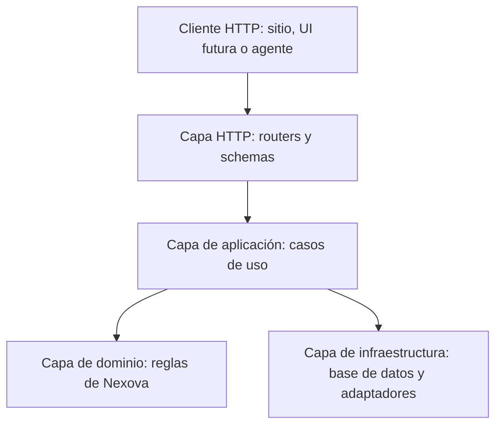
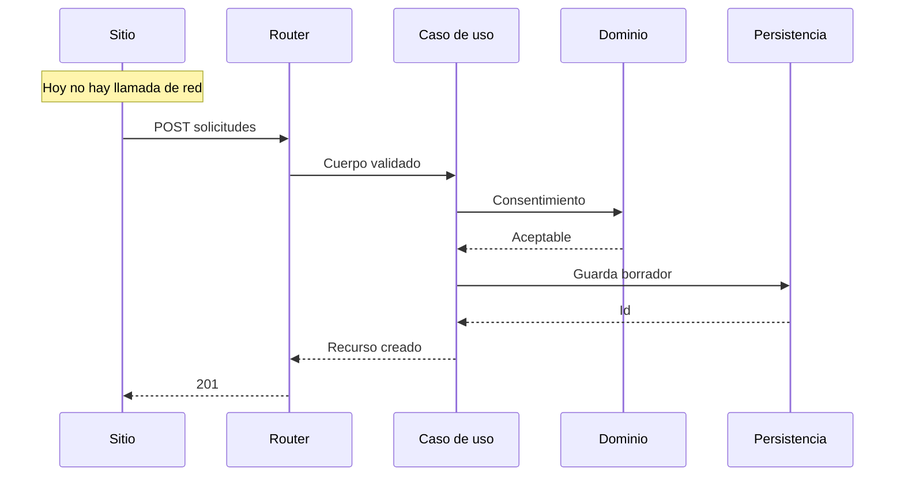
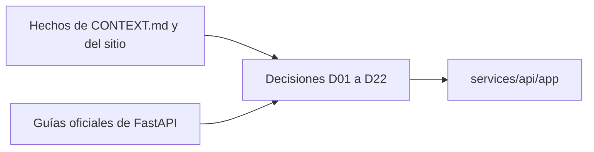

# Propuesta de arquitectura de backend

Propuesta inicial para el backend de **Nexova Solutions**, antes de crear el entorno y el primer endpoint. El destinatario es el equipo de tecnología (CTO Sergio Molina, seis personas). El entregable de esta fase es este documento: no incluye aplicación, instalación ni despliegue.

La fuente de empresa es [`CONTEXT.md`](../CONTEXT.md), declarada en [`noema.project.yaml`](../noema.project.yaml). [`BRIEFING.md`](../BRIEFING.md) repite ese texto. El sitio público ya construido (`index.html`, `application.html`, `validation.js`) es la única superficie con un contrato de datos concreto. `services/` todavía no contiene una aplicación.

## Cómo leer este documento

| Pregunta | Sección |
| --- | --- |
| Qué patrón usar y por qué encaja con Nexova | [Patrón arquitectónico](#patrón-arquitectónico) |
| Cómo quedan carpetas y módulos, y con qué criterio | [Estructura de carpetas y módulos](#estructura-de-carpetas-y-módulos) |
| Qué rutas habría y cómo se agrupan | [Endpoints y routers](#endpoints-y-routers) |
| Qué convención de FastAPI se adopta y de qué página sale | [Cómo la estructura estándar de FastAPI influye en esta propuesta](#cómo-la-estructura-estándar-de-fastapi-influye-en-esta-propuesta) |
| Cómo conviven el sitio y la API | [Frontend y backend como sistemas separados](#frontend-y-backend-como-sistemas-separados) |
| Qué decisiones técnicas quedan tomadas | [Decisiones técnicas iniciales](#decisiones-técnicas-iniciales) |
| Qué falla si el equipo no sigue esta estructura | [Riesgos y puntos de atención](#riesgos-y-puntos-de-atención) |
| Resumen trazable de cada decisión | [Mapa de decisiones](#mapa-de-decisiones) |

Los hechos del repositorio se citan con su ruta. Cada supuesto lleva la marca **Supuesto:** y está reunido al final.

## Qué hay hoy en el repositorio

Nexova Solutions es una consultora de recursos humanos fundada en 2011, con sede en Valencia y oficina de expansión en Miami. Tiene 120 personas y tres líneas de negocio: selección de mandos medios y directivos, soporte al cliente externalizado, y formación corporativa. Los clientes son medianas empresas, sobre todo de tecnología, retail y servicios financieros. Esas cifras y líneas están en `CONTEXT.md` y se repiten en la portada (`index.html`, bloque "Nexova en cifras": 2011, 120, 2 países, 3 líneas).

Áreas que el backend tiene que distinguir, porque no comparten ni usuarios ni datos:

| Área | Responsable en el briefing | Hecho operativo que condiciona la API |
| --- | --- | --- |
| Selección | Javier Almeida, 40 consultores | Cada consultor lee entre 30 y 80 CVs por proceso. El estado del candidato no es visible para el cliente. El matching depende de la intuición del consultor. |
| Formación | Elena Vargas, 12 personas | El catálogo es un PDF. La inscripción es un Google Form pasado a una hoja. La asistencia vive en Excel. |
| Soporte externalizado | Roberto Díaz, 30 agentes | Canales: teléfono, email y chat. Tiempo medio de resolución: 48 horas. SLA comprometido: 24 horas. No hay base de conocimiento. |
| Ventas | El briefing nombra a dos personas para el mismo equipo; no se fija una en el código | 18 personas. Hay HubSpot y solo el 40 % lo actualiza. La prospección y el seguimiento son manuales. |
| Marketing | Carmen Ruiz | El briefing describe la web de 2019. En este repositorio la web nueva ya está publicada como HTML estático y su formulario no envía datos. |
| RR. HH. interno | Patricia Solís, equipo de cuatro | Vacaciones, onboarding y evaluaciones por email, hojas y Google Forms. |
| Tecnología | Sergio Molina, equipo de seis | Herramientas sueltas: HubSpot, Zendesk legacy, Google Workspace, un ATS propio de principios de los años 2010 y hojas de cálculo. Sin telemetría ni registro centralizado. Despliegues manuales. |
| Dirección | Laura Mendoza | Un PDF semanal por área, preparado a mano, con datos que ya tienen días. |

El monorepo ya reparte responsabilidades. [`README.md`](../README.md) define `services/` como **una** API FastAPI centralizada, con routers por dominio, y pide no abrir microservicios al principio. `uis/` es para pantallas. `agents/` es para asistentes. `data/` separa raw, pipelines, process y eval. `packages/shared/types/index.ts` solo declara `Id` y `BaseEntity`.

Hechos de implementación que esta propuesta no puede ignorar:

- `services/` no tiene aplicación. Solo tiene el README de la plantilla.
- `uis/` no tiene aplicaciones. El sitio del hito público está en la raíz, no en `uis/website`.
- `validation.js` declara que el éxito del formulario es simulado y que no hay peticiones de red. El mensaje de éxito lo dice también al visitante.
- `README.md` anuncia `docker-compose.yml` en la raíz. Ese archivo no está.
- `agents/_template/agent.py` está vacío. Los agentes descritos en `company-choice.md` son propuestas, no procesos en ejecución.
- `data/raw/` no contiene volcados del ATS, de Zendesk ni de HubSpot.
- [`docs/ENGINEERING-STRATEGY.md`](ENGINEERING-STRATEGY.md) pide separar, más adelante, un núcleo reutilizable de la configuración de Nexova, y a la vez dice que ese dibujo no es la estructura inicial obligatoria y que generalizar antes de tiempo es sobreingeniería.

### Vocabulario

Estas palabras se mezclan en el día a día de Nexova. En la API son entidades distintas.

| Término | Qué es | Qué no es |
| --- | --- | --- |
| Cliente | Empresa que contrata a Nexova | Una persona candidata, ni un empleado de Nexova |
| Solicitante | Persona que rellena `application.html` (nombre, cargo, email) | El cliente como empresa |
| Candidato | Persona evaluada en un proceso de selección | Un empleado de la plantilla de 120 |
| Empleado | Persona de la plantilla de Nexova | Un candidato |
| Usuario final de soporte | Persona que abre una incidencia atendida por el equipo externalizado | El contacto que contrató el servicio |
| Programa | Una pieza del catálogo de formación | El valor `no-se` del formulario, que solo significa que el solicitante aún no elige formato |
| Oportunidad | Un trato comercial | Una solicitud pública todavía no aceptada por ventas |

El responsable comercial no entra en este vocabulario como constante. En la organización general de `CONTEXT.md` ese equipo lo lidera Megan Clarke. En la ficha del departamento, la misma plantilla de 18 personas (6 account managers y 12 SDR) figura a nombre de Marcos Ibáñez. Las dos frases conviven en el mismo briefing. La API guarda el responsable como dato de la oportunidad.

## Patrón arquitectónico

**Decisión:** arquitectura en capas (layered architecture), dentro de un solo proceso FastAPI en `services/api`.

La capa HTTP no contiene reglas de negocio. El caso de uso aplica la regla y, si la regla lo permite, pide a la infraestructura que guarde o consulte. La regla no importa un SDK de HubSpot, Zendesk o el ATS. La infraestructura no decide si un candidato sigue en proceso.



El mismo mapa en texto: un cliente HTTP entra por un router. El router valida la forma del mensaje y llama a un caso de uso. El caso de uso aplica una regla de dominio y, si la regla lo permite, pide a la infraestructura que guarde o consulte. El adaptador de HubSpot, Zendesk o el ATS antiguo solo existe en la infraestructura.

### Por qué esta forma encaja con Nexova

Hay tres líneas que comparten el cliente y no comparten el trabajo. Una empresa de retail puede pedir a la vez dos puestos de dirección, un equipo de soporte por chat y un taller de liderazgo: el formulario público ya permite marcar los tres servicios. La ficha de esa empresa es una. La vacante, el ticket y la inscripción son tres expedientes, con tres equipos (Javier Almeida, Roberto Díaz, Elena Vargas) y tres relojes distintos.

Las reglas que ya están escritas no son CRUD:

- En soporte, el compromiso es 24 horas y el tiempo medio observado es 48. El reloj se calcula con la fecha de apertura y el canal, no con el hecho de que exista una ruta `PATCH`.
- En selección, el briefing pide scoring y ranking explicable, y un portal donde el cliente vea el estado. Quien mueve la etapa sigue siendo el consultor: el ranking muestra qué requisito se cumple y cuál no. Un modelo posterior puede proponer el orden. La etapa "descartado" solo cambia cuando un consultor llama a una acción explícita.
- En el formulario, el consentimiento es obligatorio (`privacidad` en `validation.js`). Sin esa marca, la solicitud no se guarda.
- Dirección necesita leer indicadores de todas las áreas. Esa lectura no debe escribir vacantes ni tickets.

El equipo que lo va a mantener tiene seis personas y hoy opera un mosaico desconectado. Una sola aplicación con capas les da un sitio donde poner cada regla sin abrir un servicio por departamento. Coincide con la instrucción del `README.md` de este monorepo: una API FastAPI, routers por dominio, y un worker aparte solo cuando de verdad haga falta.

La estrategia de ingeniería del repo (`docs/ENGINEERING-STRATEGY.md`) pide, a medio plazo, extraer capacidades reutilizables (ranking, retrieval, políticas). También pide no crear esa abstracción antes de tener una interfaz estable. Las capas dejan un lugar concreto para esa extracción: `domain/seleccion` podrá partirse el día que exista una segunda implementación. Hoy hay una sola empresa. No se crea `/core` ni `/implementations/nexova`.

### Opciones revisadas

| Opción | Decisión | Motivo ligado a este sistema |
| --- | --- | --- |
| Arquitectura en capas, un proceso | Adoptada | Varias líneas comparten cliente y tienen reglas distintas. El equipo de tecnología es de seis personas. El monorepo ya pide una sola API. |
| MVC | Descartada en el backend | La vista ya existe fuera del proceso Python: HTML estático en la raíz, y las pantallas futuras en `uis/`. Un controlador MVC que renderice plantillas metería la web del hito anterior dentro de `services/` y escondería el SLA y el ranking dentro del mismo archivo que pinta HTML. |
| Serverless, una función por ruta | Descartada para el primer backend | Un proceso de selección y un ticket con reloj de 24 horas duran más que una invocación. El informe semanal de Laura y el aviso de SLA vencido tienen que correr aunque nadie llame a la API. Partir eso en funciones sueltas repetiría el mosaico actual (ATS, Zendesk, HubSpot, hojas) con más piezas y el mismo equipo de seis. |
| Microservicio por departamento | Descartada ahora | Selección, soporte, formación y ventas necesitan el mismo cliente. Cuatro servicios copiarían esa ficha. El `README.md` pide explícitamente no dividir en microservicios al principio y sacar un worker solo cuando sea necesario. |

**Supuesto:** el curso no ha fijado un proveedor serverless para este repositorio. La decisión anterior se apoya en la forma del negocio y en la plantilla del monorepo, no en una preferencia por tener un servidor encendido.

### Qué hace una solicitud cuando el formulario pase a llamar a la API

Hoy `validation.js` corta el `submit`, no llama a la red y muestra un éxito de demostración. El diagrama siguiente es el comportamiento objetivo del primer caso de uso, no una descripción del sitio actual.



Las flechas del diagrama usan etiquetas cortas. El mismo flujo, completo, en texto:

1. El navegador envía `POST /api/v1/solicitudes` con los campos que ya valida `validation.js`.
2. El router rechaza un cuerpo mal formado y no llama al caso de uso.
3. La regla exige consentimiento y al menos un servicio entre `seleccion`, `soporte` y `formacion`.
4. La persistencia guarda la solicitud y, si la empresa no existe, un cliente en borrador.
5. La respuesta es 201 con el identificador. No se crean todavía la vacante, el ticket ni la inscripción: eso ocurre cuando el equipo de esa línea acepta la solicitud.

## Estructura de carpetas y módulos

### Criterio de separación

Un módulo de dominio agrupa un sustantivo que tiene dueño, datos y condición de éxito propios.

- Misma capacidad de negocio, mismo paquete: todo lo de una vacante vive en selección, aunque el consultor y el cliente la miren con permisos distintos.
- Un sustantivo usado por varias líneas sale a su propio paquete. `Cliente` no vive dentro de selección, porque formación y soporte lo usan igual.
- La capa corta en horizontal lo que el dominio corta en vertical: HTTP, caso de uso, regla y adaptador no comparten archivo.
- Un asistente que llama a un modelo vive en `agents/`, como ya dice el mapa del monorepo. Entra a la API por HTTP, igual que el sitio. Así no puede importar la regla y saltársela.

Ese criterio deja fuera tres agrupaciones que parecerían cómodas y aquí confunden: una carpeta por persona del organigrama, una carpeta por verbo HTTP, y una carpeta "utils" para el SLA, el consentimiento y el ranking.

### Árbol propuesto

La raíz `app/`, `main.py`, `dependencies.py`, `routers/` e `internal/` siguen la guía oficial de FastAPI citada más abajo. `config.py` sale de la guía oficial de settings. `schemas/`, `services/`, `domain/` e `infrastructure/` son la extensión en capas que el tutorial oficial no trae, porque ese tutorial se detiene en las rutas.

```text
services/api/
├── app/
│   ├── __init__.py
│   ├── main.py                      # crea FastAPI, incluye routers, añade CORS
│   ├── config.py                    # Settings leídos de variables de entorno
│   ├── dependencies.py              # get_settings, sesión de datos, require_empleado
│   ├── routers/
│   │   ├── __init__.py
│   │   ├── salud.py
│   │   ├── solicitudes.py
│   │   ├── clientes.py
│   │   ├── seleccion.py
│   │   ├── soporte.py
│   │   ├── formacion.py
│   │   ├── ventas.py
│   │   ├── personas.py
│   │   └── direccion.py
│   ├── schemas/                     # forma JSON de entrada y salida, por dominio
│   ├── services/                    # un caso de uso por archivo de dominio
│   ├── domain/
│   │   ├── clientes/
│   │   ├── solicitudes/
│   │   ├── seleccion/               # etapas, ranking explicable, sin descarte automático
│   │   ├── soporte/                 # reloj de 24 horas
│   │   ├── formacion/
│   │   ├── ventas/
│   │   ├── personas/                # plantilla de Nexova, nunca candidatos
│   │   └── direccion/               # lecturas; no escribe expedientes
│   ├── infrastructure/
│   │   ├── persistence/
│   │   └── integrations/            # hubspot.py, zendesk.py, ats_legacy.py
│   └── internal/
│       ├── __init__.py
│       └── admin.py                 # salud técnica para el equipo de Sergio
└── tests/                           # las reglas se prueban sin levantar HTTP
```

`main.py` solo compone. Cada router declara su `prefix` y sus `tags`, y `main.py` lo registra con `include_router`. Un archivo nuevo de dominio obliga a tocar el registro una vez, no a buscar un hueco dentro de un archivo único.

### Qué va en cada capa

| Capa | Responsabilidad en Nexova | Ejemplo que sí entra | Ejemplo que no entra |
| --- | --- | --- | --- |
| `routers/` | Traducir HTTP | `POST /api/v1/solicitudes` responde 201 o 422 | Calcular si un ticket lleva más de 24 horas |
| `schemas/` | Forma y límites del JSON | `numPosiciones` entre 1 y 99, como el formulario | Saber qué consultor es el dueño de la vacante |
| `services/` | Ordenar el caso de uso | Aceptar una solicitud y abrir un borrador de cliente | Llamar al SDK de HubSpot |
| `domain/` | Reglas con dueño de negocio | El ranking explica cada requisito y no cambia la etapa a descartado | El nombre de la tabla SQL |
| `infrastructure/` | Datos y sistemas externos | Guardar la fila; leer el ATS por un puerto interno | Decidir el SLA |
| `internal/` | Operación del equipo técnico | Estado de los adaptadores | El informe semanal de Laura |

### Qué queda fuera de `services/api`

| Pieza | Dónde sigue | Por qué |
| --- | --- | --- |
| `index.html`, `application.html`, `validation.js` | Raíz del repo, donde ya están | Este documento no mueve el sitio. Para la API son un cliente más. |
| Pantallas futuras (portal de candidato, backoffice, dashboards) | `uis/`, una carpeta por audiencia | El `README.md` de `uis/` ya separa web pública y backoffice. |
| Agente de preselección, agente comercial, chatbot de soporte, asesor de formación, asistente de dirección | `agents/` | El modelo no es una ruta. La ruta guarda y lee; el agente propone. |
| CVs, exportaciones de ATS, tickets históricos | `data/raw` solo si están anonimizados; si no, fuera del git | El README de `data/raw` pide no subir datos sensibles. Hoy esa carpeta no tiene volcados. |
| Sets para medir el ranking o el RAG | `data/eval` | La carpeta ya existe para eso y está vacía de datasets. |
| Orquestación entre sistemas que no sea el ciclo de una petición | `workflows/` o un entrypoint planificado en el mismo código | Ver la decisión sobre workers. |

### Orden de aparición de los módulos

El orden sigue el contrato que ya existe y el peso del negocio, no el organigrama de arriba abajo.

1. `salud`, `config`, CORS y el esqueleto de `main.py`, para que el proceso arranque con orígenes explícitos.
2. `solicitudes` y `clientes`, porque son el único contrato que el repositorio ya valida en el navegador.
3. `seleccion`, porque es la línea principal de ingreso y el briefing la describe de punta a punta: briefing, criba, entrevista, contratación, estado visible.
4. `soporte`, porque el SLA ya es un número (24 frente a 48) y se puede comprobar sin un modelo.
5. `formacion`, con el vocabulario de formatos que el formulario ya usa.
6. `ventas`, detrás de un puerto `Crm`. La API no espera a tener clave de HubSpot para existir.
7. `personas`, separado de candidatos desde el primer archivo.
8. `direccion`, cuando las áreas anteriores guarden hechos. Antes de eso, un indicador devolvería vacío, que es preferible a repetir la cifra de facturación del briefing como si la API la hubiera medido.

## Endpoints y routers

### Criterio de agrupación

Hay un `APIRouter` por dominio, en su archivo, dentro de `app/routers/`. El prefijo común de producto es `/api/v1`. Cada router añade el suyo (`/solicitudes`, `/seleccion`, …) y un `tags` con el nombre del dominio, que es lo que FastAPI muestra al agrupar la documentación generada.

`app/internal/admin.py` no entra en `/api/v1`. Se incluye con prefijo `/internal`, igual que el tutorial oficial incluye el router de administración con un prefijo distinto. Ahí mira el equipo de Sergio. El informe de Laura vive en `/api/v1/direccion` y solo lee hechos de negocio.

Todas las rutas de producto, salvo `GET /api/v1/salud` y `POST /api/v1/solicitudes`, declaran la dependencia `require_empleado` en el propio router. El tutorial oficial permite colgar dependencias del `APIRouter` para no repetirlas en cada función. El formulario público es la excepción: hoy cualquiera puede abrirlo, y el consentimiento viaja en el cuerpo.

**Supuesto:** en el repositorio no hay usuarios ni proveedor de identidad. `require_empleado` es el punto donde se enganchará ese mecanismo. Esta propuesta no elige el tipo de sesión.

Las listas responden `{ "items": [], "total": 0 }` cuando no hay filas. No se rellenan con ejemplos. Un indicador que el briefing declara inexistente (rotación, absentismo, tiempo de cobertura de vacantes internas) vuelve vacío hasta que `personas` guarde hechos.

### Salud

| Método y ruta | Quién la llama | Qué hace |
| --- | --- | --- |
| `GET /api/v1/salud` | El proceso de despliegue y el equipo técnico | Responde que el proceso está vivo. No consulta HubSpot. |

### Solicitudes

Router `solicitudes.py`. Contrato copiado de `application.html` y de las reglas de `validation.js`, para que el navegador y el servidor no diverjan el día que el formulario deje de simular el envío.

| Campo | Regla que el schema debe repetir | Condición |
| --- | --- | --- |
| `nombre` | 2 a 80 caracteres, letras, al menos dos palabras | Siempre |
| `email` | Correo con dominio | Siempre |
| `telefono` | Vacío, o prefijo y entre 9 y 15 dígitos | Opcional |
| `pais` | `es`, `us` u `otro` | Siempre |
| `empresa` | 2 a 100 caracteres | Siempre |
| `cargo` | 2 a 80 caracteres | Siempre |
| `sector` | `tecnologia`, `retail`, `financieros` u `otro` | Siempre |
| `servicios` | Uno o más de `seleccion`, `soporte`, `formacion` | Siempre |
| `nivelPuesto` | `mandos-medios`, `direccion` o `ambos` | Si hay selección |
| `numPosiciones` | Entero de 1 a 99 | Si hay selección |
| `canales` | Uno o más de `telefono`, `email`, `chat` | Si hay soporte |
| `temas` | Uno o más de `liderazgo`, `comunicacion`, `gestion-equipos` | Si hay formación |
| `formato` | `curso`, `taller`, `webinar` o `no-se` | Si hay formación |
| `participantes` | Entero de 1 a 500 | Si hay formación |
| `necesidad` | 20 a 1000 caracteres | Siempre |
| `privacidad` | Tiene que venir aceptada | Siempre |

`pais` es el país de la empresa solicitante. No es la oficina de Nexova. Valencia y Miami son sedes de Nexova; el formulario no pregunta la sede. **Supuesto:** el briefing no asigna clientes de España a Valencia ni clientes de Estados Unidos a Miami. La API no inventa esa regla.

| Método y ruta | Quién la llama | Qué hace | Qué no hace |
| --- | --- | --- | --- |
| `POST /api/v1/solicitudes` | `application.html`, cuando deje de simular el envío | Crea la solicitud y un cliente en borrador si la empresa es nueva. Exige consentimiento. | No abre vacante, ticket ni inscripción. |
| `GET /api/v1/solicitudes` | Ventas | Lista solicitudes pendientes de aceptar. | No las convierte solo por listarlas. |
| `GET /api/v1/solicitudes/{id}` | Ventas | Devuelve una solicitud. | |
| `POST /api/v1/solicitudes/{id}/aceptaciones` | La persona de la línea correspondiente | Crea el expediente de esa línea: vacante, ticket o inscripción, enlazado a la solicitud. | No acepta las tres líneas en una sola llamada ciega. Cada servicio marcado se acepta por su cuenta. |

El enlace `application.html?tipo=seleccion`, `soporte` o `formacion` solo premarca una casilla en el navegador. La API no lee ese query: lee el arreglo `servicios` del cuerpo.

### Clientes

| Método y ruta | Quién la llama | Qué hace |
| --- | --- | --- |
| `GET /api/v1/clientes` | Cualquier equipo interno autorizado | Lista empresas cliente. Filtra por `sector`. |
| `POST /api/v1/clientes` | Ventas | Crea un cliente que no llegó por el formulario. |
| `GET /api/v1/clientes/{id}` | Equipos internos y el contacto de esa empresa | Ficha compartida: sector, país, estado de borrador o activo. |
| `PATCH /api/v1/clientes/{id}` | Ventas | Corrige datos de la empresa. No mueve etapas de selección. |

### Selección

Router `seleccion.py`. Cubre el recorrido que el briefing describe: briefing de la vacante, candidatos, ranking, estado visible para el cliente.

| Método y ruta | Quién la llama | Qué hace | Qué no hace |
| --- | --- | --- | --- |
| `GET /api/v1/seleccion/vacantes` | Consultores y el contacto del cliente | Lista vacantes de los clientes visibles para quien llama. | |
| `POST /api/v1/seleccion/vacantes` | Consultor, o la aceptación de una solicitud | Abre una vacante con nivel `mandos-medios`, `direccion` o `ambos`, y el número de posiciones. | No publica candidatos. |
| `GET /api/v1/seleccion/vacantes/{id}` | Consultor y contacto del cliente | Estado del proceso. | |
| `POST /api/v1/seleccion/vacantes/{id}/candidatos` | Consultor | Enlaza un candidato al proceso. | No lo ordena todavía. |
| `GET /api/v1/seleccion/candidatos` | Consultor | Lista y búsqueda. El query `q` representa peticiones como la del briefing: perfiles con experiencia en ventas B2B y nivel C1 de inglés. | No devuelve CVs de otros clientes a un contacto externo. |
| `GET /api/v1/seleccion/candidatos/{id}` | Consultor | Ficha del candidato, con `ats_legacy_id` si vino del ATS antiguo. | |
| `POST /api/v1/seleccion/vacantes/{id}/ranking` | Consultor, o más adelante el agente de `agents/` | Devuelve un orden con la explicación de cada requisito cumplido o no cumplido. | No pasa a nadie a "descartado". |
| `POST /api/v1/seleccion/procesos/{id}/etapas` | Consultor | Registra el cambio de etapa que decide la persona. | El agente no tiene esta ruta en su credencial. |
| `GET /api/v1/seleccion/procesos/{id}` | Contacto del cliente y candidato, sobre el suyo | Estado en lectura. Sustituye la llamada de "¿en qué va mi proceso?". | No muestra el ranking interno ni las notas del consultor al candidato. |

**Supuesto:** el tamaño de una terna y el plazo de una búsqueda ejecutiva no están en `CONTEXT.md`. Aparecen como idea en `company-choice.md`. El dominio guarda etapas y fechas. No fija "3 o 4 candidatos" ni "4 semanas" hasta que esa regla tenga una fuente de empresa.

### Soporte

Router `soporte.py`. El ticket pertenece a un cliente de Nexova (la empresa que contrató el equipo) y lo abre un usuario final distinto del contacto comercial.

| Método y ruta | Quién la llama | Qué hace |
| --- | --- | --- |
| `GET /api/v1/soporte/tickets` | Agentes y Roberto Díaz | Cola. El filtro `sla=vencido` usa el reloj de 24 horas. |
| `POST /api/v1/soporte/tickets` | Usuario final, agente, o la aceptación de una solicitud de soporte | Abre un ticket con canal `telefono`, `email` o `chat`. |
| `GET /api/v1/soporte/tickets/{id}` | Agente asignado y supervisor | Detalle, tiempos y estado. |
| `PATCH /api/v1/soporte/tickets/{id}` | Agente | Cambio de estado, asignación, resolución. Cada cambio guarda la hora, que es lo que permite comparar 24 y 48. |
| `GET /api/v1/soporte/cola` | Supervisor | Carga y backlog en lectura. |
| `GET /api/v1/soporte/conocimiento` | Agente y, más adelante, el asistente de primera línea | Artículos de la base que hoy está en un Word de Drive. |
| `POST /api/v1/soporte/conocimiento` | Supervisor | Alta de un artículo. |

El objetivo del briefing de resolver en torno al 40 % de las consultas sin una persona es una meta del asistente, medida en `data/eval`. No es una rama del router. El ticket guarda si respondió una persona o un asistente, y las horas. El umbral vive con el agente.

### Formación

Router `formacion.py`.

| Método y ruta | Quién la llama | Qué hace |
| --- | --- | --- |
| `GET /api/v1/formacion/programas` | Comprador, alumno y el equipo de Elena | Catálogo consultable, que hoy es un PDF trimestral. Filtro por tema: `liderazgo`, `comunicacion`, `gestion-equipos`. |
| `POST /api/v1/formacion/programas` | Equipo de formación | Alta de programa. El formato es `curso`, `taller` o `webinar`. No admite `no-se`: ese valor solo existe en la solicitud. |
| `GET /api/v1/formacion/programas/{id}` | Cualquier audiencia autorizada del catálogo | Ficha. |
| `POST /api/v1/formacion/inscripciones` | Comprador o aceptación de una solicitud | Inscripción con número de participantes entre 1 y 500. |
| `GET /api/v1/formacion/alumnos/{id}/progreso` | El alumno, sobre el suyo, y el equipo de formación | Sustituye la lista de asistencia en Excel. Vacío si todavía no hay sesiones cargadas. |
| `GET /api/v1/formacion/recomendaciones` | Equipo de formación y, más adelante, el asesor | Sugerencias por cliente. Mientras no haya historial, `items` va vacío. No devuelve el catálogo entero disfrazado de recomendación. |

### Ventas

Router `ventas.py`. Habla con un puerto `Crm` de la capa de infraestructura. El primer adaptador puede ser la base de la propia API. El adaptador de HubSpot se escribe cuando existan credenciales, que hoy no están en el repo ni en `data/raw`.

| Método y ruta | Quién la llama | Qué hace |
| --- | --- | --- |
| `GET /api/v1/ventas/oportunidades` | Account managers y SDR | Pipeline. El filtro `sin_actividad_desde` cubre los seguimientos que el briefing dice que se pierden. |
| `POST /api/v1/ventas/oportunidades` | Ventas | Abre una oportunidad ligada a un cliente. El responsable es un campo. |
| `GET /api/v1/ventas/oportunidades/{id}` | Dueño de la oportunidad | Ficha, actividad e historial. |
| `PATCH /api/v1/ventas/oportunidades/{id}` | Dueño | Cambio de etapa comercial. |
| `POST /api/v1/ventas/oportunidades/{id}/actividades` | Dueño | Registra un contacto o un seguimiento. |
| `POST /api/v1/ventas/oportunidades/{id}/borradores` | La persona, o más adelante el agente comercial | Guarda un borrador de siguiente paso. El envío al prospecto es otra acción, hecha por una persona. |

### Personas

Router `personas.py`. Solo la plantilla de Nexova. Un candidato no tiene ruta aquí.

| Método y ruta | Quién la llama | Qué hace |
| --- | --- | --- |
| `GET /api/v1/personas/empleados` | RR. HH. | Plantilla. |
| `POST /api/v1/personas/empleados` | RR. HH. | Alta. Dispara el checklist de onboarding, vacío y progresivo. |
| `GET /api/v1/personas/empleados/{id}` | RR. HH. y el propio empleado | Ficha acotada al rol. |
| `POST /api/v1/personas/ausencias` | El empleado | Solicitud de vacaciones o ausencia, que hoy viaja por email. |
| `GET /api/v1/personas/onboarding/{empleado_id}` | RR. HH. y el empleado | Checklist. |
| `GET /api/v1/personas/indicadores` | RR. HH. y dirección | Rotación, absentismo y tiempo de cobertura interna. Respuesta vacía hasta que haya hechos. El briefing dice que esas métricas no existen. |

### Dirección

Router `direccion.py`. Solo lectura. Compone servicios de las otras áreas. No tiene `POST` de vacantes, tickets ni oportunidades.

| Método y ruta | Quién la llama | Qué hace |
| --- | --- | --- |
| `GET /api/v1/direccion/indicadores` | Laura Mendoza y quien ella autorice | Hechos ya guardados: procesos abiertos, tickets fuera de 24 horas, inscripciones, oportunidades sin actividad. |
| `GET /api/v1/direccion/informe-semanal` | Dirección | Último informe generado por el job planificado. Sustituye el PDF manual. Si el job no ha corrido, la respuesta lo dice y no adjunta cifras de relleno. |

No hay router de marketing en esta versión. El briefing pide visitas, fuentes y conversión, y el sitio estático no emite esos eventos. Inventar `GET /api/v1/marketing/conversion` devolvería un número sin medición.

### Internas del equipo técnico

| Método y ruta | Quién la llama | Qué hace |
| --- | --- | --- |
| `GET /internal/adaptadores` | Equipo de tecnología | Dice si el puerto de HubSpot, Zendesk y el ATS tiene adaptador configurado o sigue vacío. |
| `GET /internal/salud` | Equipo de tecnología | Detalle del proceso, distinto del indicador de negocio. |

## Cómo la estructura estándar de FastAPI influye en esta propuesta

Se revisaron tres páginas de la documentación oficial de FastAPI. Lo que sigue es lo que cada una fija en este árbol, y lo que esta propuesta añade porque Nexova lo necesita.

### Aplicaciones grandes, varios archivos

Fuente: [Bigger Applications - Multiple Files](https://fastapi.tiangolo.com/tutorial/bigger-applications/).

La página dice que una API casi nunca cabe en un solo archivo y muestra este árbol: paquete `app` con `__init__.py`, `main.py`, `dependencies.py`, subpaquete `routers/` (`items.py`, `users.py`) y subpaquete `internal/` (`admin.py`). Cada carpeta lleva `__init__.py` para poder importar módulos. Las rutas de un área se declaran con `APIRouter`, descrito ahí como un FastAPI pequeño. El prefijo, las etiquetas y las dependencias comunes se cuelgan del router, no de cada función. `main.py` incorpora cada router con `include_router`. El router interno se incorpora con un `prefix` distinto (`/admin` en el ejemplo).

En esta propuesta eso se traduce así:

- El paquete es `services/api/app`, no un archivo suelto en la raíz del monorepo.
- Hay un módulo por dominio dentro de `routers/`, en el papel de `users.py` e `items.py`.
- `dependencies.py` concentra `get_settings` y `require_empleado`.
- `internal/admin.py` queda fuera del prefijo de producto.
- `main.py` no declara las rutas de selección ni de soporte: solo llama a `include_router`.

La página no habla de reglas de negocio ni de bases de datos. Por eso el árbol de Nexova añade `schemas/`, `services/`, `domain/` e `infrastructure/` debajo del mismo paquete, sin romper el esqueleto anterior.

### CORS

Fuente: [CORS (Cross-Origin Resource Sharing)](https://fastapi.tiangolo.com/tutorial/cors/).

La página define un origen como protocolo + dominio + puerto, y pone como ejemplo que `http://localhost` y `http://localhost:8080` son orígenes distintos. El navegador solo deja que el JavaScript llame al otro origen si el backend responde al preflight `OPTIONS` con una lista explícita. Muestra `CORSMiddleware` de `fastapi.middleware.cors`, con `allow_origins` en una lista. Advierte que el comodín `"*"` no sirve para peticiones con credenciales, y que `allow_origins`, `allow_methods` y `allow_headers` no pueden ser `"*"` cuando `allow_credentials` es verdadero.

Eso entra en `main.py`: el middleware se registra al crear la aplicación, y la lista de orígenes sale de `config.py`, no de una lista escrita a mano con el puerto del portátil de una persona.

### Settings y variables de entorno

Fuente: [Settings and Environment Variables](https://fastapi.tiangolo.com/advanced/settings/).

La página pide sacar de las variables de entorno lo que cambia entre máquinas y lo que es secreto (claves, URL de base de datos). Recomienda `BaseSettings` de `pydantic-settings`, un módulo `config.py` al lado de `main.py`, y una dependencia `get_settings` cacheada con `lru_cache` para leer el entorno una vez y poder sustituirla en los tests. También documenta leer un archivo `.env` sin commitearlo como si fuera código.

Eso fija `app/config.py` y la dependencia en `app/dependencies.py`. Esta propuesta no instala el paquete: solo deja decidido que la configuración entra por ahí el día que el sprint abra el entorno.

### Qué se copia y qué se añade

| Pieza | Origen |
| --- | --- |
| `app/__init__.py`, `main.py`, `dependencies.py`, `routers/`, `internal/`, `APIRouter`, `prefix`, `tags`, `include_router` | Guía de aplicaciones grandes |
| `CORSMiddleware` y orígenes explícitos | Guía de CORS |
| `config.py`, `BaseSettings`, `get_settings` sustituible en tests | Guía de settings |
| `schemas/`, `services/`, `domain/`, `infrastructure/` y los nombres de dominio de Nexova | Esta propuesta, por las reglas y los sistemas descritos arriba |

## Frontend y backend como sistemas separados

### Un monorepo, dos sistemas

Siguen en este repositorio. No se abre un repositorio nuevo para la API.

El monorepo ya separa clientes y servidor: `uis/` para pantallas, `services/` para la API, `packages/shared` para tipos que ambos pudieran compartir. El equipo que los va a hacer es el mismo grupo de seis, y el único tipo compartido que existe hoy es un marcador de posición. Partir el git ahora obligaría a sincronizar dos repos antes de tener un segundo consumidor real.

Aun así, el sitio y la API son sistemas distintos:

- Se despliegan por separado. El sitio es estático. La API es un proceso Python.
- No comparten memoria ni imports. El HTML no importa `app.domain`. La API no renderiza `index.html`.
- El contrato es JSON sobre HTTP. FastAPI publica el esquema OpenAPI desde las rutas. Esa es la especificación. Una copia escrita a mano en `shared/` se queda vieja en cuanto cambie un schema; si alguna UI necesita un archivo estático, se genera, no se edita.
- El sitio actual está en la raíz, no en `uis/website`. **Supuesto de alcance:** moverlo no forma parte de esta propuesta. La API trata `https://<origen-del-sitio>` como un origen permitido más, esté la carpeta donde esté.

Los agentes, cuando existan, son un tercer cliente HTTP. No son un frontend y no se cuelan en `routers/`.

### Comunicación

El primer cruce real será `POST /api/v1/solicitudes`. Hasta ese cambio, `validation.js` sigue simulando el éxito y el documento no pide modificarlo.

Cuando se conecte:

- La base URL pública del API viaja en la configuración del sitio (`API_BASE_URL`). No es un secreto: el navegador la ve igual.
- El cuerpo usa los nombres de campo de la tabla de solicitudes, en el mismo castellano técnico que el formulario (`numPosiciones`, `nivelPuesto`), para no traducir el contrato a mitad de camino.
- Un 422 devuelve el `detail` estándar de FastAPI, que el formulario puede llevar a su resumen de errores. No se inventa un segundo sobre de error por cada router.
- Un 201 devuelve el identificador. El texto de éxito del sitio solo puede decir que la solicitud quedó registrada cuando esa respuesta haya llegado. Hoy el texto dice lo contrario, y con razón: es una demostración.

`packages/shared/types/index.ts` podrá reflejar esos JSON cuando exista una UI en TypeScript. Mientras el único cliente es el HTML de la raíz, la fuente del contrato de la solicitud es `validation.js` más el schema del servidor.

### CORS, con los orígenes de este repo

El `README.md` arranca el sitio con `npx --yes serve -l 3000`. La guía de settings de FastAPI muestra la API en el puerto 8000. Aunque el puerto local de la API se fijara en otro valor, protocolo, host y puerto del sitio y de la API no coinciden: el navegador los trata como orígenes distintos y envía un `OPTIONS` antes del `POST`.

**Supuesto:** en local, el sitio sigue en el puerto 3000 documentado y la API en otro puerto. En un entorno publicado, cada uno tendrá su origen real. Esos orígenes no se conocen todavía en el repo.

Consecuencias, tomadas de la guía de CORS:

- `allow_origins` sale de la variable `CORS_ORIGINS`, separada por comas, leída en `config.py`.
- La lista incluye el origen exacto del sitio, con protocolo y puerto. Un ejemplo local sería `http://localhost:3000`. El origen de Codespaces, cuando el puerto 3000 se marca público como pide el README, es otro valor y también tiene que estar en la lista de ese entorno.
- Con cookies o cabecera `Authorization`, `allow_credentials` será verdadero y la lista no puede ser `"*"`. El formulario público puede vivir sin credenciales; las rutas de consultor, no.
- Métodos y cabeceras que use el sitio se declaran en configuración. El valor por defecto del middleware, según la guía, deja `allow_methods` en `GET` y `allow_headers` vacío: un `POST` con `Content-Type: application/json` no pasaría el preflight si nadie lo abre.

### Variables de entorno

| Variable | Dónde vive | Secreto | Uso |
| --- | --- | --- | --- |
| `CORS_ORIGINS` | Proceso de la API | No | Lista explícita de orígenes del sitio y de las UI |
| `APP_ENV` | Proceso de la API | No | Distingue local, prueba y publicado |
| `DATABASE_URL` | Proceso de la API | Sí | Conexión a la base relacional |
| `API_BASE_URL` | Sitio y UI | No | Dónde llama el navegador |
| Claves de HubSpot, Zendesk o del ATS, el día que existan | Proceso de la API | Sí | Solo dentro de `infrastructure/integrations` |

El archivo `.env` lo lee `Settings`, como describe la guía oficial, y no se versiona. `index.html` y `validation.js` no reciben esas claves. Un agente tampoco las recibe en el navegador: si un agente necesita un sistema externo, llama a una ruta de la API y el adaptador usa la clave en el servidor.

Los tests sustituyen `get_settings` por la vía que documenta FastAPI (`dependency_overrides`), de modo que la suite no depende del `.env` de una persona.

## Decisiones técnicas iniciales

1. **Base relacional para los expedientes.** Un cliente tiene muchas vacantes, una vacante tiene muchos candidatos, un ticket tiene un reloj, una inscripción tiene alumnos. Eso es relación, no un documento suelto por pantalla. **Supuesto:** el motor no está elegido; no hay `docker-compose.yml` ni cadena de conexión. La recomendación es PostgreSQL cuando se escriba ese compose. Hasta entonces el dominio no importa el motor: lo importa `infrastructure/persistence`.
2. **Identificador legado opcional.** Candidato, ticket y oportunidad pueden guardar `ats_legacy_id`, `zendesk_legacy_id` u `hubspot_legacy_id`. Así un volcado futuro no duplica personas. Hoy `data/raw` no tiene ese volcado, así que los adaptadores arrancan vacíos y la API funciona igual.
3. **El ranking no descarta.** `POST .../ranking` devuelve orden y explicación. `POST .../etapas` es la única escritura de etapa, y la credencial del agente no la incluye. Encaja con el pedido del briefing (ranking explicable y estado visible) y deja la decisión de descarte en el consultor.
4. **Reloj de soporte en el dominio.** `domain/soporte` calcula el incumplimiento a partir de la apertura y del compromiso de 24 horas. El router solo expone el filtro. Un job del mismo repositorio, no un segundo servicio, recorre los tickets vencidos para el aviso al supervisor. Se extraerá a `services/<worker>` solo si ese proceso tiene que escalar aparte, que es la condición que pone el README.
5. **Informe semanal como lectura de un snapshot.** Un entrypoint planificado escribe el snapshot. `GET /api/v1/direccion/informe-semanal` lo lee. Sustituye el PDF que hoy prepara a mano cada responsable de área. Si el job no corrió, la respuesta lo dice.
6. **Agentes como clientes.** El agente de preselección y el agente comercial descritos en `company-choice.md` consumirán ranking, candidatos y borradores. No se implementan en este paso y no se importan como librería interna de `app`.
7. **Sin métricas inventadas.** La facturación aproximada de 8 millones y el 40 % de uso de HubSpot son cifras del briefing, no series que la API mida. El 40 % de consultas de soporte resueltas sin una persona es un objetivo del briefing, no un dato ya observado. Los indicadores salen de filas guardadas o vuelven vacíos.
8. **Registro estructurado, herramienta sin elegir.** Cada petición escribe una línea con ruta, estado y dominio. Cubre el hueco que el briefing señala (nadie se entera de un fallo hasta que un usuario llama). **Supuesto:** no se elige producto de telemetría; el README del curso reserva ese terreno a un hito posterior. El hueco es `infrastructure`, no una llamada suelta dentro de cada router.
9. **PII fuera del git.** CVs, ausencias y tickets de usuarios finales no se commitean. El README de `data/raw` ya lo pide. El consentimiento de la solicitud se guarda con la solicitud.

## Riesgos y puntos de atención

Estos puntos describen qué se rompe si el equipo no sigue la estructura anterior.

### Si todas las rutas se escriben en un solo archivo

Selección, soporte, formación, ventas, plantilla y dirección acabarían en el mismo módulo. Un arreglo del reloj de 24 horas obligaría a releer el portal del candidato. Con seis personas y el historial de herramientas sueltas que describe el briefing, ese archivo se convierte en el siguiente mosaico, solo que dentro de Python. La estructura lo evita con un router por dominio y un `include_router` en `main.py`.

### Si el candidato y el empleado comparten módulo

La plantilla de Patricia Solís (contratos, vacaciones, evaluaciones) y la base de candidatos de Javier Almeida quedarían bajo las mismas rutas y la misma autorización. Un portal de cliente para "ver en qué va mi proceso" podría alcanzar una ausencia de un empleado, o un consultor podría quedar bloqueado por reglas de RR. HH. interno. Van en `domain/seleccion` y `domain/personas`, con routers distintos.

### Si el contacto que contrata y el usuario final del soporte son la misma entidad

El formulario pide el cargo de quien contrata, por ejemplo una dirección de RR. HH. El ticket de soporte lo abre un cliente de esa empresa, por teléfono, email o chat. Unirlos hace que la cola de Roberto Díaz mezcle compradores con incidencias, y que el SLA de 24 horas se mida sobre la persona equivocada. `Cliente` es la empresa. El ticket tiene un usuario final propio.

### Si el descarte del candidato vive en el router del ranking

Cualquier cliente de `POST .../ranking`, incluido un agente futuro, cambiaría la etapa al pedir un orden. El briefing pide un ranking explicable y un estado visible, no una contratación automática. La estructura separa la lectura del orden y la escritura de la etapa, y no entrega la segunda credencial al agente.

### Si la solicitud crea a la vez vacante, ticket e inscripción

El formulario permite marcar los tres servicios y hoy avisa de que no envía datos. El día que envíe, crear tres expedientes en el `POST` metería trabajo en las colas de Javier, Roberto y Elena antes de que nadie acepte. Ventas perdería el triaje. El `POST` guarda la solicitud; cada línea acepta la suya con `POST /api/v1/solicitudes/{id}/aceptaciones`.

### Si CORS queda abierto o clavado a un solo localhost

La guía oficial trata como orígenes distintos el sitio y la API cuando cambian el puerto o el protocolo. El sitio de este repo está documentado en el puerto 3000 y la API irá en otro. Un `allow_origins` con `"*"` y credenciales no cumple la restricción que la propia guía marca. Un origen fijo `http://localhost:3000` dentro de `main.py` funciona en una máquina y falla en cuanto el README pide publicar el puerto 3000 de Codespaces, o en cuanto el sitio tenga un dominio real. La lista sale de `CORS_ORIGINS`.

### Si el nombre de la persona que lidera ventas se escribe en el código

`CONTEXT.md` nombra a Megan Clarke en la organización general y a Marcos Ibáñez en la ficha del departamento, para el mismo equipo de 18 personas. Una constante en `ventas.py` obliga al equipo a "corregir" el briefing dentro del código. El responsable es un campo de la oportunidad.

### Si cada departamento estrena un servicio desplegable

Cliente, consentimiento y autenticación se copiarían en selección, soporte, formación y ventas. El README del monorepo pide una sola API precisamente para no pagar ese coste al empezar. Con seis personas, cuatro despliegues manuales más repiten el problema que Sergio Molina ya tiene.

### Si se codifican reglas comerciales que el briefing no contiene

`docs/decision-analysis.md` menciona condiciones comerciales y plazos de búsqueda que `CONTEXT.md` no contiene. Meterlas en `domain/ventas` o en `domain/seleccion` fabricaría política. La estructura deja esas reglas fuera hasta que vivan en el briefing o en un archivo de política citado. Las únicas cifras operativas que el dominio de soporte puede usar hoy son las 24 horas comprometidas y las 48 horas de media observada.

### Puntos de atención adicionales

- **Deriva del formulario.** Si el schema relaja `participantes` por encima de 500 o admite un `formato` que `validation.js` rechaza, el sitio y la API dejarán de contar la misma solicitud. El schema de solicitudes se revisa contra la tabla de este documento, que sale de `validation.js`.
- **Dos especificaciones.** Editar un OpenAPI a mano en `shared/` mientras FastAPI genera otro hace que las UI futuras hablen con rutas que ya no existen.
- **Generalizar a un núcleo reutilizable en el primer sprint.** `docs/ENGINEERING-STRATEGY.md` lo marca como dirección, no como carpeta inicial. Crear `/core` antes de tener selección funcionando añade módulos sin un segundo caso de uso.
- **Indicadores de marketing.** Carmen Ruiz necesita visitas y conversión. El sitio no emite eventos. Una ruta que devuelva una tasa sin medición empeora el PDF semanal: parecería fresco y sería inventado.

## Mapa de decisiones

| ID | Decisión | Dónde queda | Fuente |
| --- | --- | --- | --- |
| D01 | Arquitectura en capas dentro de un proceso | `services/api/app` | Esta propuesta, sobre `CONTEXT.md` y el README del monorepo |
| D02 | Una sola API, sin microservicios por área | `services/api` | `README.md`, sección `services/` |
| D03 | MVC fuera del backend | Los HTML siguen siendo clientes | Sitio en la raíz; `uis/README.md` |
| D04 | Serverless fuera del primer backend | Job en el mismo código; worker aparte solo si hace falta | Reloj de 24 h e informe semanal en `CONTEXT.md` |
| D05 | Router por dominio, registro con `include_router` | `app/routers/*.py`, `app/main.py` | Guía oficial de aplicaciones grandes |
| D06 | Prefijo de producto `/api/v1` y prefijo técnico `/internal` | `main.py` | La misma guía, patrón `prefix` del router interno |
| D07 | Dependencias compartidas en un módulo | `app/dependencies.py` | La misma guía |
| D08 | Configuración por variables de entorno | `app/config.py` | Guía oficial de settings |
| D09 | Orígenes CORS explícitos, sin comodín con credenciales | `CORSMiddleware` en `main.py` | Guía oficial de CORS |
| D10 | El sitio y la API no se importan | Clientes HTTP | Monorepo: `uis/` y `services/` |
| D11 | Primera ruta de producto: la solicitud del formulario | `routers/solicitudes.py` | `validation.js` y `application.html` |
| D12 | Aceptar cada línea por separado | `POST .../aceptaciones` | El formulario permite combinar servicios |
| D13 | Candidato distinto de empleado | `domain/seleccion`, `domain/personas` | Javier Almeida frente a Patricia Solís en `CONTEXT.md` |
| D14 | Usuario final de soporte distinto del contacto comercial | Ticket con su propio actor | Canales y formulario |
| D15 | El ranking explica y no descarta | Dos rutas de selección | Briefing de selección |
| D16 | SLA de 24 h en el dominio, no en el router | `domain/soporte` | Cifras 24 y 48 de `CONTEXT.md` |
| D17 | Agentes fuera de la API, como clientes | `agents/` | README del monorepo; `company-choice.md` como intención |
| D18 | Sin cifras de relleno en dirección y RR. HH. | Respuesta vacía | El briefing dice qué métricas no existen |
| D19 | Responsable comercial como dato | Campo de la oportunidad | Megan Clarke y Marcos Ibáñez, ambas en `CONTEXT.md` |
| D20 | No codificar política ausente del briefing | Fuera del dominio | `decision-analysis.md` frente a `CONTEXT.md` |
| D21 | Identificadores legados opcionales | Columnas en infraestructura | ATS, Zendesk y HubSpot descritos, sin volcado en `data/raw` |
| D22 | PII fuera del git | No hay CVs en el repo | `data/raw/README.md` |



El mismo mapa en texto: los hechos de Nexova y las tres guías oficiales alimentan las decisiones D01–D22. Esas decisiones se materializan en un solo paquete `services/api/app`. Ninguna decisión de la tabla exige un repositorio nuevo ni un servicio por departamento.

## Supuestos

Quedan fuera de los hechos del repositorio. Si alguno es falso, se corrige la decisión marcada y no el resto.

| # | Supuesto | Decisión que depende de él |
| --- | --- | --- |
| S1 | El motor relacional aún no está elegido. PostgreSQL es la recomendación cuando exista el compose que el README anuncia y que hoy no está. | D01, persistencia |
| S2 | En local el sitio sigue en el puerto 3000 y la API escucha en otro origen. Los orígenes publicados todavía no están en el repo. | D09 |
| S3 | No hay proveedor de identidad. `require_empleado` es un hueco, no un login elegido. | D07 |
| S4 | La API no bloquea su existencia a la espera de claves de HubSpot, Zendesk o el ATS. | D21 |
| S5 | Mover `index.html` a `uis/website` no entra en este documento. | D10 |
| S6 | Los agentes de `company-choice.md` son intención. `agents/_template/agent.py` está vacío. | D17 |
| S7 | No se asignan clientes españoles a Valencia ni estadounidenses a Miami: el briefing no lo dice. | Campo `pais` |
| S8 | Terna, plazo de búsqueda ejecutiva y condiciones comerciales citadas fuera de `CONTEXT.md` no son regla de dominio. | D20 |
| S9 | La herramienta de telemetría se elige en un hito posterior. | Registro estructurado |

## Fuentes

Documentación oficial de FastAPI, consultada para esta propuesta:

- [Bigger Applications - Multiple Files](https://fastapi.tiangolo.com/tutorial/bigger-applications/): árbol `app/`, `APIRouter`, `dependencies.py`, `internal/`, `include_router`, prefijo y etiquetas.
- [CORS (Cross-Origin Resource Sharing)](https://fastapi.tiangolo.com/tutorial/cors/): definición de origen, `CORSMiddleware`, lista explícita, límite del comodín cuando hay credenciales.
- [Settings and Environment Variables](https://fastapi.tiangolo.com/advanced/settings/): variables de entorno, `BaseSettings`, `config.py`, dependencia `get_settings`, archivo `.env`.

Repositorio:

- [`CONTEXT.md`](../CONTEXT.md), fuente de empresa. [`BRIEFING.md`](../BRIEFING.md) es el mismo texto.
- [`README.md`](../README.md), secciones `services/`, `uis/` y el sitio público.
- [`validation.js`](../validation.js) y [`application.html`](../application.html), contrato de la solicitud.
- [`docs/ENGINEERING-STRATEGY.md`](ENGINEERING-STRATEGY.md), límite a la abstracción prematura.
- [`docs/decision-analysis.md`](decision-analysis.md), material que no debe promoverse a regla mientras no esté en el briefing.
- [`company-choice.md`](../company-choice.md), intención de agentes, no comportamiento implementado.
- [`data/raw/README.md`](../data/raw/README.md), PII fuera del repo.
- [`packages/shared/types/index.ts`](../packages/shared/types/index.ts), tipos compartidos todavía vacíos de dominio.
- [`noema.project.yaml`](../noema.project.yaml), declara `CONTEXT.md` como fuente de contexto.

## Cómo comprobar este documento

Desde la raíz del repositorio:

```bash
python3 scripts/check_architecture_proposal.py
```

El script confirma las secciones que pide el encargo, la presencia de las convenciones de FastAPI citadas, al menos dos riesgos, los diagramas Mermaid cerrados y el marcado de supuestos. No instala FastAPI ni arranca un servidor: el entregable de esta fase es el documento.
