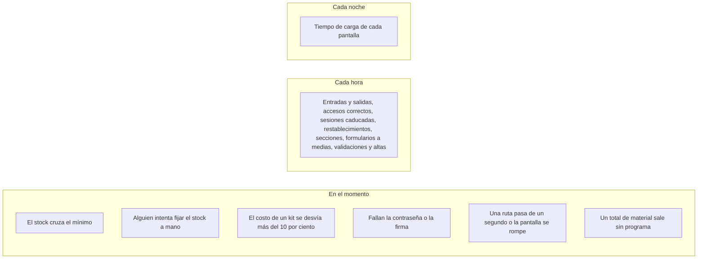

# Plan de telemetría de Nexova

Respuesta al RFI de dirección: qué puede contar hoy el sistema de inventario y el resto del backoffice, antes de instrumentar nada. Este documento y `event-schemas.json` son el contrato. Otro desarrollador puede emitir cada evento desde el código que ya está en el monorepo sin volver a preguntar el nombre, la clave o la condición.

Hay **19 eventos**. **5 son obligatorios** (vienen del briefing de telemetría de Nexova). **14 son oportunidades identificadas** en el código actual. Las categorías son negocio, autenticación, rendimiento, errores y navegación.

No hay código de captura en esta entrega. El validador de `docs/telemetry/validate_event_schemas.py` comprueba el esquema contra ejemplos. No envía eventos.

## 1. Fuentes

| Fuente | Qué fija |
| --- | --- |
| Syllabus `ai-eng-telemetry-plan` @ `fd2da034894ba93ba738559280ccde074ab1d953` | El envelope, el catálogo amplio y la prohibición de instrumentar ahora. SHA256 del README: `a742b60ff0108eab8455af9498e9636e2e1059b0912fef1fe10f29b956349b77`. |
| `content/contexts/06-telemetry-data-pipelines/telemetry/nexova-BRIEFING.md` @ el mismo commit. Copia en `source/nexova-BRIEFING.md`. SHA256 `b9aee8a9dfde725d75d695f08f1027e14d635edeb6782f23d884987c0b72e097`. | Las cinco métricas, las entidades, la moneda y la prohibición de nombres de personas. |
| `nexova-BRIEFING.es.md`, SHA256 `c0d3e6db92867fdb4575d5e993cebce5e95982e7cc76c8c6dd486254aa45afa8`. | Los mismos cinco `event_type` y las mismas claves. Los ejemplos de `programme_id` cambian de idioma. |

Los cinco `event_type` obligatorios, copiados tal cual:

| `event_type` | Se dispara cuando | Quién decide |
| --- | --- | --- |
| `inbound_order_created` | Llega un lote de material desde un proveedor | Elena, producción de material |
| `outbound_order_created` | Se entrega un kit o un certificado | Elena, reposición antes de una ola de matrículas |
| `stock_threshold_triggered` | El stock cae por debajo del mínimo configurado | Elena, umbral o reimpresión |
| `direct_stock_edit_rejected` | Alguien intenta modificar el stock fuera de una orden y el sistema lo rechaza | Patricia, formación o permisos en esa oficina |
| `kit_cost_variance_detected` | El costo unitario de una entrada se desvía más del histórico del mismo material y proveedor | Elena y Laura, renegociar o cambiar de proveedor |

El piso de `properties` en los eventos de inventario es `office`, `product_id`, `product_category`, `programme_id`, `quantity` y `currency`. `office` vale `valencia` o `miami`. `product_category` vale `training_kit`, `certification` u `onboarding_equipment`. `currency` vale `EUR` o `USD`.

Los ejemplos de programa del briefing inglés son `b2b-sales` y `basic-leadership`. Los del briefing español son `ventas-b2b` y `liderazgo-basico`. Son ejemplos, no un catálogo cerrado, y no están asignados a ningún SKU de la semilla. La telemetría guarda el slug que Elena escriba. No lo traduce. El idioma de la interfaz y la oficina son dimensiones distintas: este plan no tiene una propiedad de idioma.

## 2. Qué hay hoy en el código

El inventario vivo no usa los nombres del briefing de telemetría. Usa el modelo del hito de backend.

| En el briefing de telemetría | En el código de esta rama | Dónde |
| --- | --- | --- |
| `Product` | Tabla `asset`. Columnas `id`, `name`, `sku`, `category`, `office`. | `services/api/app/inventory/models.py` `Asset` |
| `InboundOrder` | Tabla `assetentry`. | `AssetEntry` |
| `OutboundOrder` | Tabla `assetexit`. | `AssetExit` |
| Stock | No es columna. Es `SUM(entradas) − SUM(salidas)`. | `stock_by_asset` en `service.py` |
| Orden de entrada | `POST /inventory/orders/inbound` → `create_entry` | `routers/inventory.py`, `service.py` |
| Orden de salida | `POST /inventory/orders/outbound` → `create_exit` | Los mismos archivos |
| Alta de producto | `POST /inventory/products` → `create_asset` | Los mismos |
| Usuario de la orden | `user_uuid`, el id de TinyDB del token. El cliente no puede enviarlo: `AssetEntryCreate` tiene `extra=forbid` y el test `user_uuid` ajeno responde 422. | `schemas.py`, `tests/test_inventory.py` |
| Umbral mínimo | No está en la API. El panel usa `LOW_STOCK_BELOW = 10`. | `uis/backoffice/lib/stock.ts` |
| Costo unitario | No hay columna ni campo de petición. | `AssetEntry` y `AssetEntryCreate` |
| `programme_id` | No hay columna. | `Asset` |

Categorías vivas, el `Literal` de `schemas.py`: `hardware`, `peripherals`, `office_supplies`, `training_materials`. Oficinas vivas: `Valencia` y `Miami`, con mayúscula.

Semilla (`services/api/app/inventory/seed.py`):

| SKU | Nombre en la semilla | `asset.category` | Oficina | Stock neto | `product_category` de este plan |
| --- | --- | --- | --- | --- | --- |
| `NXV-IT-001` | Laptop 14" Business | `hardware` | Valencia | 12 | `onboarding_equipment` |
| `NXV-IT-002` | Laptop 14" Business | `hardware` | Miami | 6 | `onboarding_equipment` |
| `NXV-PER-001` | Ergonomic mouse | `peripherals` | Valencia | 20 | `onboarding_equipment` |
| `NXV-PER-002` | USB-C Hub | `peripherals` | Miami | 0 | `onboarding_equipment` |
| `NXV-OFF-001` | A4 paper ream | `office_supplies` | Valencia | 18 | Fuera de las métricas de material |
| `NXV-TRN-001` | Leadership training workbook | `training_materials` | Valencia | 15 | `training_kit` |

`NXV-IT-002` ya está en 6, por debajo de 10. Leer el listado no dispara `stock_threshold_triggered`. El evento solo nace en el cruce.

### Tabla de correspondencia `proposed-2026-11-12`

Esta tabla es normativa para el emisor de mañana. Lleva versión porque Elena puede corregirla. Cada evento de material guarda `category_map_version` con el valor `proposed-2026-11-12`.

| `asset.category` | `product_category` | Motivo, atado al briefing y a la semilla |
| --- | --- | --- |
| `hardware` | `onboarding_equipment` | El briefing llama equipo de incorporación al portátil de asignación. La semilla hardware es ese portátil. |
| `peripherals` | `onboarding_equipment` | El ratón y el hub de la semilla acompañan a ese kit. |
| `training_materials` | `training_kit` | El workbook de la semilla es material de formación. |
| `office_supplies` | Sin fila | El papel no es kit, certificado ni equipo de incorporación. Esas filas siguen en Postgres y en el panel. No entran en las cinco métricas. |

`certification` queda en el enum para el día en que un alta traiga esa categoría de forma explícita. El emisor no la deduce del nombre del producto.

`programme_id` vale el slug de la columna el día que exista. Mientras `asset` no tenga esa columna, el emisor escribe `unassigned`. Es un cubo de calidad, no un programa de Elena. El dashboard de matrículas deja fuera `unassigned`. Al lado sale `catalogue_gap_recorded` con `gap = missing_programme`, para que el total de Laura no parezca completo.

### Moneda

| Oficina en la fila | `office` del evento | `currency` |
| --- | --- | --- |
| `Valencia` | `valencia` | `EUR` |
| `Miami` | `miami` | `USD` |

La moneda se deriva de la oficina. El cliente no la elige. Valencia en euros y Miami en dólares no se suman en esta capa. Un cuerpo futuro que traiga una moneda distinta de la oficina responde 422 y emite `order_validation_failed` con `failure_code = currency_office_mismatch`. Hoy ese cuerpo no existe: `AssetEntryCreate` no tiene costo ni moneda.

## 3. Envelope

Todos los eventos llevan el mismo sobre. `schemaVersion` de esta entrega es `1.0.0`.

| Campo | Regla |
| --- | --- |
| `eventId` | UUID v4 creado al armar el evento. No es el id de la orden. |
| `timestamp` | ISO 8601 con hora y zona, en UTC, en el momento de emitir. El patrón del esquema es `YYYY-MM-DDTHH:MM:SS` con `Z` o con desplazamiento `±HH:MM`. El `format: date-time` solo no basta: el validador de esta máquina no trae el checker de fechas, y el patrón sí rechaza `12/11/2026`. |
| `sessionId` | UUID v4 guardado en `sessionStorage` con la clave `nexova.telemetry.session`, enviado en `X-Nexova-Session`. Si la cabecera no viene, el valor es `missing`. |
| `userId` | El id de TinyDB, el mismo `user_uuid` de `AssetEntry` y `AssetExit`. Si no hay cuenta, `anonymous`. Nunca el correo. |
| `event_type` | `entidad_accion`, de la lista cerrada del esquema. |
| `schemaVersion` | `1.0.0`. |
| `requestId` | UUID v4 de `X-Request-Id`. Si la petición no lo trae, el middleware lo crea, lo guarda en la petición y lo devuelve en la misma cabecera. |
| `properties` | Objeto. Solo las claves de la allowlist de ese `event_type`. |

`timestamp` es cuándo se construye el evento. `occurred_at`, cuando existe, es el `created_at` de la fila. Un reproceso posterior no reescribe la hora de la entrega.

El sobre y cada `properties` llevan `additionalProperties: false`. Una clave de más invalida el evento. El emisor tira el evento entero si falta una clave obligatoria. No rellena con cero ni con una cadena vacía.

Hoy no existe `X-Request-Id`. El middleware `timing_middleware` de `services/api/app/main.py` escribe en el log `api.timing` la ruta con la query. El evento usa `request.scope["route"].path`, la plantilla, y deja la query fuera.

## 4. Personas, secretos y saneado

`userId` es el identificador interno que ya viaja en la orden. Hace falta para unir la telemetría con `user_uuid`. No es un correo y no se hashea: el informe de Patricia necesita la misma oficina y la misma cuenta que la orden.

| Dato | Tratamiento |
| --- | --- |
| Correo, contraseña, token, cuerpo del reset | Fuera de `properties`. `password_reset_requested` no dice si la cuenta existe: `POST /auth/forgot-password` siempre responde 200 y el evento solo lleva `outcome = accepted` y `userId = anonymous`. |
| `assigned_to` | La columna admite texto libre. La semilla guarda `NXV-EMP-1042` y `NXV-EMP-2201`. Si el valor coincide con `^NXV-EMP-[0-9]+$`, viaja como `assignee_ref`. Cualquier otro texto activa `assignee_redacted = true` y `assignee_ref` no se envía. El esquema prohíbe las dos cosas a la vez. |
| Nombre de candidato, cliente o consultor | Fuera. El briefing lo prohíbe. `asset.name` también se queda fuera: un alta futura puede meter un nombre de persona en el título del kit. El SKU identifica el material. |
| `supplier` | Nombre de organización, el de la columna, hasta 200 caracteres, sin `@` y sin saltos de línea. Un correo en ese campo tira la clave. |
| IP | `forgot_password` ya lee la IP para el límite por hora. El evento no la copia. |
| Mensaje de error de pantalla | Se guarda `error.name` y el SHA-256 de un texto saneado. El texto es `error.name`, un salto de línea, y el mensaje recortado a 300 caracteres después de sustituir correos por `[email]` y cada tanda de 3 o más dígitos por `[n]`. El ejemplo `frontend_exception_recorded` hashea `TypeError\nCannot read properties of undefined`, sin dígitos ni correo. El digest es `b7b32534990c138f77d0b6a7d0d9d0d58ad07faca7c6d5ab1d69c54bcc459036`. |
| `reason=expired` en el cliente | No es fuente de `session_expired`. `uis/backoffice/lib/http.ts` llama a `redirectToLogin("expired")` en todo 401. `uis/portal/lib/api.ts` `leaveForLogin` pone `reason=expired` en todo 401, también cuando no había token. |

Clasificación de un bearer, en `get_current_user` y `decode_access_token` (`app/auth/deps.py`, `app/auth/security.py`):

1. Sin token: `credential_rejected` / `missing_token`. El mensaje actual es «Falta el token de acceso.»
2. `ExpiredSignatureError` de python-jose, y una segunda decodificación con la firma comprobada y `exp` sin comprobar, con `exp` ya pasado: `session_expired` / `exp_claim`. `userId` es el `sub`. Hoy el `except JWTError` convierte caducidad y firma mala en el mismo `TokenError` («El token no es válido o ha caducado.»). El emisor tiene que separar la excepción antes de ese mensaje.
3. Firma inválida: `credential_rejected` / `bad_signature`. `userId = anonymous`. No se lee el cuerpo de un token con la firma rota.
4. `sub` vacío o distinto de `user_uuid`: `credential_rejected` / `subject_mismatch`.
5. Usuario ausente o `is_active` falso. El mensaje actual también dice que el token caducó. El emisor ya comprobó `exp`. Esto es `credential_rejected` / `inactive_or_unknown`.
6. El 403 «No puedes consultar ni modificar las credenciales de otro usuario.» de `app/auth/service.py`: `credential_rejected` / `foreign_credentials`.

`login_failed` es solo el 401 de `authenticate` en `POST /auth/login`: «El correo o la contraseña no son válidos.» Un cuerpo malformado de login es un 422 y no es este evento.

## 5. Catálogo

| `event_type` | Clase | Categoría | Entrega | Cadencia |
| --- | --- | --- | --- | --- |
| `inbound_order_created` | obligatorio | negocio | batch | cada hora |
| `outbound_order_created` | obligatorio | negocio | batch | cada hora |
| `stock_threshold_triggered` | obligatorio | negocio | stream | en el momento |
| `direct_stock_edit_rejected` | obligatorio | negocio | stream | en el momento |
| `kit_cost_variance_detected` | obligatorio | negocio | stream | en el momento |
| `order_validation_failed` | identificada | negocio | batch | cada hora |
| `asset_created` | identificada | negocio | batch | cada hora |
| `catalogue_gap_recorded` | identificada | negocio | stream | en el momento |
| `login_failed` | identificada | autenticación | stream | en el momento |
| `login_succeeded` | identificada | autenticación | batch | cada hora |
| `session_expired` | identificada | autenticación | batch | cada hora |
| `credential_rejected` | identificada | autenticación | stream | en el momento |
| `password_reset_requested` | identificada | autenticación | batch | cada hora |
| `api_latency_recorded` | identificada | rendimiento | stream | en el momento |
| `page_load_recorded` | identificada | rendimiento | batch | cada noche |
| `frontend_exception_recorded` | identificada | errores | stream | en el momento |
| `api_response_failed` | identificada | errores | stream | en el momento |
| `section_viewed` | identificada | navegación | batch | cada hora |
| `flow_abandoned` | identificada | navegación | batch | cada hora |

## 6. Flujo de inventario, de la sesión a la orden

El operador entra por `uis/backoffice/components/LoginScreen.tsx`, que llama a `POST /auth/login`. Con el token, `SessionGate` deja pasar `/backoffice/inventory/*`. Las pantallas son Activos, Entrada, Salida e Historial (`InventoryNav`). La entrada llama a `createAssetEntry` y la salida a la ruta de outbound. El stock que muestra el formulario sale de `GET /inventory/products/{id}` y es de solo lectura: el texto dice «Stock actual (current_stock)» y el cliente no lo reenvía.

Puntos de instrumentación de ese recorrido. Los tres que el enunciado pide a la fuerza están marcados.

1. **Acceso autenticado.** `login_succeeded` o `login_failed` en `login()` de `app/routers/auth.py`. Sin un 200 el operador no llega al inventario. `section_viewed` con `section = backoffice_inventory_products` cuando la ruta pasa a ser esa, ya con token.
2. **Formulario.** `section_viewed` al abrir `/backoffice/inventory/orders/inbound` o `.../outbound`. Si el operador escribió un campo y se va antes del 201, `flow_abandoned` con `flow = inventory_inbound` o `inventory_outbound`.
3. **Validación fallida.** `order_validation_failed`. Sale de `create_exit` (400, stock insuficiente), del validador de `AssetExitCreate` (422, `assigned_to`), de `create_entry` (422, proveedor vacío), de `_office_filter` (422) y de `_lock_asset` (404). El 422 por un `user_uuid` metido en el cuerpo es `forbidden_user_uuid`.
4. **Intento de editar el stock a mano.** `direct_stock_edit_rejected`. El caso que ya cubre el test es `POST /inventory/products` con `current_stock: 40`: `AssetCreate` tiene `extra = forbid` y `invalid_request` en `main.py` responde 422. La misma clave en una orden también es 422.
5. **Orden completada.** `inbound_order_created` al final de `create_entry`, después del `flush`, cuando ya hay `InventoryOrderRead`. `outbound_order_created` al final de `create_exit`, después de que el stock alcanzó.
6. **Umbral.** `stock_threshold_triggered` en ese mismo `create_exit`, con `previous_stock` igual al `available` que la función ya calculó y `current_stock = available - quantity`. Solo si `previous_stock >= threshold` y `current_stock < threshold`.
7. **Costo.** `kit_cost_variance_detected` en `create_entry`, el día que la petición traiga `unit_cost_minor` y exista un histórico. Hoy el campo no está. El evento queda especificado y no se simula.

`catalogue_gap_recorded` acompaña a los puntos 4, 5 y 6 cuando `programme_id` es `unassigned`.

## 7. Eventos

Cada ficha trae la frase que justifica el evento, el sitio exacto de enganche, la entrega y la allowlist. El ejemplo válido está en `examples/valid/<event_type>.json`.

<!-- event: inbound_order_created | origin: mandatory | category: business | delivery: batch -->

### inbound_order_created

Capturamos `inbound_order_created` porque necesitamos saber cuánto material entra, de qué programa y en qué moneda, lo que nos permite tomar la decisión de cuánto producir la semana que viene (Elena).

**Clase:** obligatorio. **Enganche:** `create_entry`, después del `flush` y con la fila leída. La categoría viva tiene fila en `proposed-2026-11-12`. `office_supplies` no emite este evento. **PII:** `userId` es el uuid de la orden. `supplier` es la organización. Sin nombres de personas.

**Entrega: batch, cada hora.** Elena planifica la producción con el acumulado del día, no en el minuto en que el almacén registra el albarán. La alarma de desabastecimiento es `stock_threshold_triggered`, que sí va en el momento. Esperar a la noche dejaría a Elena sin la cifra del mismo día; una hora cabe en esa revisión.

Obligatorias: office, product_id, product_category, programme_id, quantity, currency, order_id, product_sku, category_map_version

Allowlist: office, product_id, product_category, programme_id, quantity, currency, order_id, product_sku, category_map_version, supplier, occurred_at

| Propiedad | Tipo | Obligatorio | Descripción |
| --- | --- | --- | --- |
| office | string `valencia` \| `miami` | sí | Oficina normalizada. |
| product_id | string | sí | `Asset.id` en decimal. |
| product_category | string `training_kit` \| `certification` \| `onboarding_equipment` | sí | Categoría del briefing, según la tabla versionada. |
| programme_id | string slug | sí | Programa, o `unassigned`. |
| quantity | entero 1…1000000 | sí | Unidades de `AssetEntry.quantity`. |
| currency | string `EUR` \| `USD` | sí | Derivada de la oficina. |
| order_id | entero ≥ 1 | sí | `AssetEntry.id`. |
| product_sku | string | sí | `Asset.sku`. |
| category_map_version | string `proposed-2026-11-12` | sí | Versión de la tabla. |
| supplier | string 1…200, sin `@` | no | Organización proveedora. |
| occurred_at | fecha ISO 8601 | no | `created_at` de la fila. |

<!-- event: outbound_order_created | origin: mandatory | category: business | delivery: batch -->

### outbound_order_created

Capturamos `outbound_order_created` porque necesitamos saber qué programas consumen material y a qué ritmo, lo que nos permite tomar la decisión de reponer antes de una ola de matrículas (Elena).

**Clase:** obligatorio. **Enganche:** `create_exit`, después del `flush`, solo si el stock alcanzó. Misma regla de categoría que la entrada. **PII:** `assigned_to` se reduce a `assignee_ref` o a `assignee_redacted`, según la sección 4.

**Entrega: batch, cada hora.** La pregunta de operaciones es cuántas salidas hay al día y qué programa tira más. Esa cifra se lee en una tanda. El cruce del mínimo no espera a la tanda: va en `stock_threshold_triggered`.

Obligatorias: office, product_id, product_category, programme_id, quantity, currency, order_id, product_sku, exit_type, category_map_version

Allowlist: office, product_id, product_category, programme_id, quantity, currency, order_id, product_sku, exit_type, category_map_version, assignee_ref, assignee_redacted, occurred_at

| Propiedad | Tipo | Obligatorio | Descripción |
| --- | --- | --- | --- |
| office | string `valencia` \| `miami` | sí | Oficina de la salida. |
| product_id | string | sí | `Asset.id` en decimal. |
| product_category | string del enum del briefing | sí | Categoría traducida. |
| programme_id | string slug | sí | Programa, o `unassigned`. |
| quantity | entero ≥ 1 | sí | Unidades de `AssetExit.quantity`. |
| currency | string `EUR` \| `USD` | sí | Moneda de la oficina. |
| order_id | entero ≥ 1 | sí | `AssetExit.id`. |
| product_sku | string | sí | SKU. |
| exit_type | string `allocation` \| `consumption` | sí | Columna `exit_type`. |
| category_map_version | string constante | sí | Versión de la tabla. |
| assignee_ref | string `NXV-EMP-` y dígitos | no | Solo si `assigned_to` ya era ese id. |
| assignee_redacted | boolean | no | Verdadero si `assigned_to` traía otro texto. Entonces `assignee_ref` no va. |
| occurred_at | fecha ISO 8601 | no | `created_at`. |

<!-- event: stock_threshold_triggered | origin: mandatory | category: business | delivery: stream -->

### stock_threshold_triggered

Capturamos `stock_threshold_triggered` porque necesitamos saber en qué momento un material cruza su mínimo, lo que nos permite tomar la decisión de parar entregas de ese kit o encargar la reimpresión el mismo día (Elena).

**Clase:** obligatorio. **Enganche:** `create_exit`, con el `available` que la función ya tiene antes de insertar. `previous_stock = available`, `current_stock = available - quantity`, `threshold = 10` mientras no exista `asset.min_stock`. El día que esa columna exista, el valor de la fila gana para ese activo. `direction` es siempre `fell_below` y `order_type` es siempre `outbound`: una entrada no reduce stock. El evento se rearma cuando una entrada posterior deja el stock otra vez en el umbral o por encima. `NXV-IT-002` y `NXV-PER-002` ya están por debajo en la semilla y no generan un evento retrospectivo.

**PII:** la misma regla de ids. Sin nombres.

**Entrega: stream.** El material ya no cubre el mínimo. Otra salida puede dejar el kit en cero antes de que cierre la tanda horaria. Elena decide en minutos, no al día siguiente.

Obligatorias: office, product_id, product_category, programme_id, quantity, currency, product_sku, current_stock, previous_stock, threshold, direction, order_type, category_map_version

Allowlist: office, product_id, product_category, programme_id, quantity, currency, product_sku, current_stock, previous_stock, threshold, direction, order_type, category_map_version, order_id

| Propiedad | Tipo | Obligatorio | Descripción |
| --- | --- | --- | --- |
| office | string `valencia` \| `miami` | sí | Oficina del activo. |
| product_id | string | sí | `Asset.id` en decimal. |
| product_category | string del enum del briefing | sí | Categoría traducida. |
| programme_id | string slug | sí | Programa, o `unassigned`. |
| quantity | entero ≥ 1 | sí | Unidades de la salida que cruzó. |
| currency | string `EUR` \| `USD` | sí | Moneda de la oficina. |
| product_sku | string | sí | SKU. |
| current_stock | entero ≥ 0 | sí | Stock después de la salida. |
| previous_stock | entero ≥ 0 | sí | El `available` de `create_exit`. |
| threshold | entero ≥ 1 | sí | 10 hasta que exista `min_stock`. |
| direction | string `fell_below` | sí | Solo el cruce hacia abajo. |
| order_type | string `outbound` | sí | La salida es el movimiento que resta. |
| category_map_version | string constante | sí | Versión de la tabla. |
| order_id | entero ≥ 1 | no | `AssetExit.id`. |

<!-- event: direct_stock_edit_rejected | origin: mandatory | category: business | delivery: stream -->

### direct_stock_edit_rejected

Capturamos `direct_stock_edit_rejected` porque necesitamos saber si alguien intenta saltarse la trazabilidad del material, lo que nos permite tomar la decisión de reforzar la formación o los permisos en la oficina donde más ocurre (Patricia).

**Clase:** obligatorio. **Enganche:** el manejador `invalid_request` de `app/main.py` cuando el estado es 422, la ruta empieza por `/inventory` y alguna entrada de `exc.errors()` tiene `current_stock` en `loc`. El test de `tests/test_inventory.py` que envía `current_stock: 40` al alta de `NXV-PER-012` es el caso de referencia: `quantity` del evento es 40, `product_id` y `product_sku` son `NXV-PER-012` porque la fila no llegó a insertarse, `product_category` es `onboarding_equipment` (periférico en la tabla), `programme_id` es `unassigned`, `http_status` es 422 y `rejected_field` es `current_stock`.

Un 405 de `PUT` o `PATCH` sobre `/inventory/products/{asset_id}` emite el evento solo si el cuerpo trae un entero en `current_stock` o en `quantity`. `rejected_field` es `method` y `http_status` es 405. Un 405 sin número no dice qué stock querían imponer y no emite este evento. `office_supplies` tampoco lo emite: no hay `product_category` del briefing. El 422 sigue ocurriendo; la métrica de Patricia, para el papel, queda fuera a propósito y está en las exclusiones.

**PII:** sin el cuerpo crudo. El número intentado va en `quantity`.

**Entrega: stream.** El intento está pasando en esa sesión. Patricia actúa mientras la cuenta sigue identificada. Una tanda de la noche pierde ese momento, y el control de trazabilidad vive de ver el intento antes de que la persona pruebe otro camino.

Obligatorias: office, product_id, product_category, programme_id, quantity, currency, product_sku, http_status, rejected_field, route_template, category_map_version

Allowlist: office, product_id, product_category, programme_id, quantity, currency, product_sku, http_status, rejected_field, route_template, category_map_version

| Propiedad | Tipo | Obligatorio | Descripción |
| --- | --- | --- | --- |
| office | string `valencia` \| `miami` | sí | Oficina del cuerpo, normalizada. |
| product_id | string | sí | Id en decimal si la fila existe. Si el alta se rechazó, el SKU enviado. |
| product_category | string del enum del briefing | sí | Traducción. Sin fila en la tabla, no hay evento. |
| programme_id | string slug | sí | De la fila, o `unassigned`. |
| quantity | entero | sí | El entero que intentaron imponer. |
| currency | string `EUR` \| `USD` | sí | Derivada de la oficina. |
| product_sku | string | sí | SKU del cuerpo o de la fila. |
| http_status | entero 405 \| 422 | sí | 422 con `current_stock`. 405 con método inexistente. |
| rejected_field | string `current_stock` \| `method` | sí | Atado al estado: `current_stock` con 422, `method` con 405. |
| route_template | string | sí | Plantilla de la ruta, sin query. |
| category_map_version | string constante | sí | Versión de la tabla. |

<!-- event: kit_cost_variance_detected | origin: mandatory | category: business | delivery: stream -->

### kit_cost_variance_detected

Capturamos `kit_cost_variance_detected` porque necesitamos saber cuándo el costo unitario de un proveedor se separa del histórico del mismo material, lo que nos permite tomar la decisión de frenar el siguiente pedido y renegociar o buscar otro proveedor (Elena y Laura).

**Clase:** obligatorio. **Enganche previsto:** `create_entry`, cuando el cuerpo traiga `unit_cost_minor` (céntimos de la moneda de la oficina). El histórico es la mediana de los `unit_cost_minor` ya guardados del mismo `product_id`, `supplier` y `currency`. Hace falta al menos un costo previo. `variance_ratio` es el valor absoluto de `(nuevo − histórico) / histórico`. El evento se emite si ese ratio es mayor que `threshold_ratio`. El umbral inicial es `0.1`, el 10 % del ejemplo del briefing. Si el histórico es 0, no hay división y no hay evento.

Hoy `AssetEntry` no tiene costo y `AssetEntryCreate` rechaza claves de más. Este plan no añade la columna. Hasta que el proyecto de captura la añada, el evento no puede dispararse. No se inventa un costo para la semilla.

**PII:** `supplier` es la organización. Sin personas.

**Entrega: stream.** El pedido que cruzó el 10 % puede ir seguido de otro pedido al mismo proveedor esa misma tarde. Laura y Elena frenan el siguiente antes de confirmarlo. Una tanda nocturna dejaría pasar ese segundo pedido.

Obligatorias: office, product_id, product_category, programme_id, quantity, currency, order_id, product_sku, supplier, unit_cost_minor, historical_unit_cost_minor, variance_ratio, threshold_ratio, category_map_version

Allowlist: office, product_id, product_category, programme_id, quantity, currency, order_id, product_sku, supplier, unit_cost_minor, historical_unit_cost_minor, variance_ratio, threshold_ratio, category_map_version, occurred_at

| Propiedad | Tipo | Obligatorio | Descripción |
| --- | --- | --- | --- |
| office | string `valencia` \| `miami` | sí | Oficina de la entrada. |
| product_id | string | sí | `Asset.id` en decimal. |
| product_category | string del enum del briefing | sí | Categoría traducida. |
| programme_id | string slug | sí | Programa, o `unassigned`. |
| quantity | entero ≥ 1 | sí | Unidades de esa entrada. |
| currency | string `EUR` \| `USD` | sí | Moneda de la oficina. No se convierte. |
| order_id | entero ≥ 1 | sí | `AssetEntry.id`. |
| product_sku | string | sí | SKU. |
| supplier | string sin `@` | sí | Organización. Agrupa el histórico. |
| unit_cost_minor | entero ≥ 0 | sí | Costo unitario en céntimos. La columna aún no existe. |
| historical_unit_cost_minor | entero ≥ 1 | sí | Mediana previa. Cero no es base. |
| variance_ratio | número > 0 | sí | Desviación relativa absoluta. |
| threshold_ratio | número `0.1` | sí | Umbral del briefing. |
| category_map_version | string constante | sí | Versión de la tabla. |
| occurred_at | fecha ISO 8601 | no | `created_at` de la entrada. |

<!-- event: order_validation_failed | origin: identified | category: business | delivery: batch -->

### order_validation_failed

Capturamos `order_validation_failed` porque necesitamos saber qué productos acumulan rechazos al registrar una orden, lo que nos permite tomar la decisión de corregir el formulario o reponer ese SKU.

**Clase:** identificada. Cubre la pregunta de operaciones sobre errores de validación, distinta del intento de escribir `current_stock`. **Enganche:** las excepciones ya existentes, con este mapa.

| `failure_code` | Dónde sale hoy | HTTP |
| --- | --- | --- |
| `insufficient_stock` | `create_exit`, cantidad mayor que `available` | 400 |
| `unknown_asset` | `_lock_asset` no encuentra el id | 404 |
| `assigned_to_rule` | `AssetExitCreate.assigned_to_follows_exit_type` | 422 |
| `empty_supplier` | `create_entry`, proveedor en blanco | 422 |
| `bad_office` | `_office_filter` | 422 |
| `forbidden_user_uuid` | cuerpo con `user_uuid` y `extra = forbid` | 422 |
| `quantity_rule` | `quantity` que no es un entero mayor que cero | 422 |
| `currency_office_mismatch` | cuerpo futuro con moneda distinta de la oficina | 422 |

El `detail` del 400 nombra el activo y las cantidades. El evento no copia esa frase: las cantidades van en `quantity` y el producto en `product_id` / `product_sku`.

**PII:** sin la frase de error y sin `assigned_to`.

**Entrega: batch, cada hora.** El operador ya ve el error en el formulario. La decisión es qué SKU acumula fallos, y eso es un conteo. Un 400 suelto no cambia el turno.

Obligatorias: failure_code, route_template, http_status

Allowlist: failure_code, route_template, http_status, product_id, product_sku, office, quantity, exit_type

| Propiedad | Tipo | Obligatorio | Descripción |
| --- | --- | --- | --- |
| failure_code | string del enum de arriba | sí | Regla que rechazó la orden. |
| route_template | string | sí | `/inventory/orders/inbound` o `/inventory/orders/outbound`. |
| http_status | entero 400 \| 404 \| 422 | sí | El estado de la tabla. El esquema ata el código al estado. |
| product_id | string | no | `asset_id` del cuerpo, en decimal. |
| product_sku | string | no | SKU si la fila se leyó. |
| office | string `valencia` \| `miami` | no | Solo si el cuerpo traía Valencia o Miami. |
| quantity | entero | no | La cantidad enviada, si era un entero. |
| exit_type | string `allocation` \| `consumption` | no | Si el cuerpo lo traía. |

<!-- event: asset_created | origin: identified | category: business | delivery: batch -->

### asset_created

Capturamos `asset_created` porque necesitamos saber qué ítems entran al catálogo, lo que nos permite tomar la decisión de revisar si el alta es un kit de formación o material que este plan deja fuera del informe de Elena.

**Clase:** identificada. **Enganche:** `create_asset`, después del `flush`. Aquí sí entra `office_supplies`, en `live_category`. `product_category` solo va si la tabla tiene fila, y entonces `category_map_version` es obligatorio. `programme_id` solo va si la columna ya tiene slug. Este evento no usa `unassigned`: la ausencia se omite.

**PII:** sin el nombre libre del activo.

**Entrega: batch, cada hora.** Un alta de ratón se revisa con el resto del catálogo del día. No cambia una decisión en el minuto.

Obligatorias: product_id, product_sku, office, currency, live_category

Allowlist: product_id, product_sku, office, currency, live_category, product_category, programme_id, category_map_version

| Propiedad | Tipo | Obligatorio | Descripción |
| --- | --- | --- | --- |
| product_id | string | sí | `Asset.id` en decimal. |
| product_sku | string | sí | SKU guardado. |
| office | string `valencia` \| `miami` | sí | Oficina normalizada. |
| currency | string `EUR` \| `USD` | sí | Derivada de la oficina. |
| live_category | string `hardware` \| `peripherals` \| `office_supplies` \| `training_materials` | sí | El valor de la columna. |
| product_category | string del enum del briefing | no | Solo con fila en la tabla. |
| programme_id | string slug | no | Solo si la columna ya tiene valor. |
| category_map_version | string constante | no | Obligatoria en el esquema si `product_category` está. |

<!-- event: catalogue_gap_recorded | origin: identified | category: business | delivery: stream -->

### catalogue_gap_recorded

Capturamos `catalogue_gap_recorded` porque necesitamos saber cuántos eventos de material salen sin programa o chocan con una categoría desconocida, lo que nos permite tomar la decisión de no publicar el total de Elena como si el programa estuviera completo.

**Clase:** identificada. **Enganche:** el mismo sitio que el evento de material.

| `gap` | Qué hace el emisor |
| --- | --- |
| `missing_programme` | El evento obligatorio sí se emite, con `programme_id = unassigned`. Este evento va al lado y `affected_event` dice cuál. |
| `unmapped_category` | La categoría no es ninguna de las cuatro de `schemas.py` ni tiene fila en la tabla. El evento obligatorio no se emite. `office_supplies` no usa este hueco: es una exclusión conocida, no una sorpresa. |

**PII:** ids y SKU. Sin nombres.

**Entrega: stream.** El hueco cambia el significado del total que Elena va a leer. Tiene que verse en la misma hora en que entra el material, antes de que la tanda horaria se tome por completa.

Obligatorias: gap, affected_event, product_id, product_sku

Allowlist: gap, affected_event, product_id, product_sku, live_category, office

| Propiedad | Tipo | Obligatorio | Descripción |
| --- | --- | --- | --- |
| gap | string `missing_programme` \| `unmapped_category` | sí | Tipo de hueco. |
| affected_event | string, uno de los cinco obligatorios | sí | Evento de material afectado. |
| product_id | string | sí | La misma identidad que usaría el evento afectado. |
| product_sku | string | sí | SKU. |
| live_category | string de las cuatro categorías vivas | no | Columna, cuando se conoce. |
| office | string `valencia` \| `miami` | no | Oficina, cuando se conoce. |

<!-- event: login_failed | origin: identified | category: authentication | delivery: stream -->

### login_failed

Capturamos `login_failed` porque necesitamos saber cuántos intentos de acceso fracasan y en qué sesión se concentran, lo que nos permite tomar la decisión de tratar esa hora como un ataque o como una contraseña rota (Sergio).

**Clase:** identificada. **Enganche:** `login()` en `app/routers/auth.py`, rama `ServiceError` con estado 401. `userId` es `anonymous`. **PII:** sin correo y sin contraseña. El mensaje público ya no dice cuál de los dos falló, y el evento tampoco.

**Entrega: stream.** Una ráfaga es de esa hora. Sergio decide si frena esa sesión el mismo día. No se descarta ningún intento: ocultar fallos escondería el ataque. El tope de la sección 9 no aplica aquí.

Obligatorias: failure_code

Allowlist: failure_code

| Propiedad | Tipo | Obligatorio | Descripción |
| --- | --- | --- | --- |
| failure_code | string `invalid_credentials` | sí | El 401 de `authenticate`. |

<!-- event: login_succeeded | origin: identified | category: authentication | delivery: batch -->

### login_succeeded

Capturamos `login_succeeded` porque necesitamos saber cuántos operadores entran cada día, lo que nos permite tomar la decisión de incluir los accesos activos en el reporte semanal de Laura.

**Clase:** identificada. **Enganche:** `login()`, después de `TokenResponse.model_validate` y antes del `return`. `userId` es `record["id"]`. `expires_in_seconds` es el `expires_in` de esa respuesta. El `access_token` no viaja.

**PII:** el uuid de la cuenta. Sin token y sin correo.

**Entrega: batch, cada hora.** Un acceso correcto alimenta el conteo semanal. No es una incidencia.

Obligatorias: expires_in_seconds

Allowlist: expires_in_seconds

| Propiedad | Tipo | Obligatorio | Descripción |
| --- | --- | --- | --- |
| expires_in_seconds | entero 1…86400 | sí | Vida del token, en segundos. |

<!-- event: session_expired | origin: identified | category: authentication | delivery: batch -->

### session_expired

Capturamos `session_expired` porque necesitamos saber con qué frecuencia caduca el token en medio del trabajo, lo que nos permite tomar la decisión de alargar `ACCESS_TOKEN_EXPIRE_MINUTES` o corregir el reloj del cliente.

**Clase:** identificada. **Enganche:** el paso 2 de la sección 4, en `get_current_user`. `surface` es `api` cuando lo detecta el servidor. El backoffice y el portal pueden emitir `surface = backoffice` o `portal` solo si decodifican el payload del token que ya tenían, comprueban que `exp` pasó, y no se fían del query `reason`. **PII:** `userId` es el `sub` de un token con la firma válida.

**Entrega: batch, cada hora.** Una caducidad suelta es el comportamiento del token. La decisión sale del conteo del día.

Obligatorias: surface, reason

Allowlist: surface, reason

| Propiedad | Tipo | Obligatorio | Descripción |
| --- | --- | --- | --- |
| surface | string `api` \| `backoffice` \| `portal` | sí | Dónde se comprobó `exp`. |
| reason | string `exp_claim` | sí | Firma válida y `exp` ya pasado. |

<!-- event: credential_rejected | origin: identified | category: authentication | delivery: stream -->

### credential_rejected

Capturamos `credential_rejected` porque necesitamos saber si llegan firmas inválidas, cuentas inactivas o lecturas de credenciales ajenas, lo que nos permite tomar la decisión de revocar ese acceso el mismo día (Sergio).

**Clase:** identificada. **Enganche:** los pasos 1, 3, 4, 5 y 6 de la sección 4. **PII:** sin el token. `userId` es `anonymous` en `bad_signature` y en `missing_token`. En `inactive_or_unknown`, `subject_mismatch` y `foreign_credentials` es el uuid si la firma ya se comprobó.

**Entrega: stream.** Una firma mala o un token de una cuenta inactiva es un intento de reutilizar acceso. Se mira en el momento, igual que un login fallido. `missing_token` sí tiene tope: cada llamada anónima a una ruta protegida lo produciría. Ver la sección 9.

Obligatorias: failure_code, surface

Allowlist: failure_code, surface, dropped_count

| Propiedad | Tipo | Obligatorio | Descripción |
| --- | --- | --- | --- |
| failure_code | string `bad_signature` \| `missing_token` \| `inactive_or_unknown` \| `subject_mismatch` \| `foreign_credentials` | sí | Motivo, distinto del 401 de login. |
| surface | string `api` \| `backoffice` \| `portal` | sí | Dónde se rechazó. |
| dropped_count | entero ≥ 0 | no | `missing_token` por encima de 60 en un minuto, en ese proceso. |

<!-- event: password_reset_requested | origin: identified | category: authentication | delivery: batch -->

### password_reset_requested

Capturamos `password_reset_requested` porque necesitamos saber el volumen de restablecimientos sin saber quién lo pidió, lo que nos permite tomar la decisión de comparar ese volumen con `login_failed` y ver si el correo de recuperación se cayó.

**Clase:** identificada. **Enganche:** `forgot_password` en `app/routers/auth.py`, después de `request_password_reset`, siempre. No se consulta si el correo tiene cuenta para rellenar `userId`. **PII:** `userId = anonymous`. Sin correo, sin IP, sin token de un solo uso.

**Entrega: batch, cada hora.** La decisión compara volúmenes del día. Un restablecimiento suelto no llama a nadie, y el usuario ya recibió la respuesta 200.

Obligatorias: outcome

Allowlist: outcome

| Propiedad | Tipo | Obligatorio | Descripción |
| --- | --- | --- | --- |
| outcome | string `accepted` | sí | La ruta respondió 200 con el mensaje único. |

<!-- event: api_latency_recorded | origin: identified | category: performance | delivery: stream -->

### api_latency_recorded

Capturamos `api_latency_recorded` porque necesitamos saber qué rutas pasan de un segundo o responden 5xx, lo que nos permite tomar la decisión de mirar esa ruta mientras el operador sigue en la pantalla (Sergio).

**Clase:** identificada. **Enganche:** `timing_middleware` en `app/main.py`, cuando `duration_ms >= 1000` o `status_code >= 500`. La plantilla sale de la ruta de FastAPI, no de la línea de log que concatena la query. `cache_mark` copia `X-Nexova-Cache` (`HIT`, `MISS`) o `none`.

El percentil de las respuestas rápidas sigue viviendo en el log `api.timing`. Este evento es la alarma, no el histograma. En el proyecto de caché, `GET /inventory/orders` con volumen medía unos 110 ms en caliente de lectura: eso queda por debajo de la línea y no emite. El ejemplo del esquema usa 1105 ms para ser un caso que sí se emitiría.

**PII:** sin query y sin cuerpo.

**Entrega: stream.** El operador está esperando esa respuesta ahora. La cifra de mañana no le quita la espera de hoy.

Obligatorias: http_method, route_template, status_code, duration_ms

Allowlist: http_method, route_template, status_code, duration_ms, dropped_count, cache_mark

| Propiedad | Tipo | Obligatorio | Descripción |
| --- | --- | --- | --- |
| http_method | string `GET` \| `POST` \| `PUT` \| `PATCH` \| `DELETE` | sí | Método. |
| route_template | string | sí | Plantilla, sin query. |
| status_code | entero 100…599 | sí | Estado de la respuesta. |
| duration_ms | número 0…600000 | sí | Milisegundos del middleware. |
| dropped_count | entero ≥ 0 | no | Descartados por el tope de 30 por minuto y plantilla. |
| cache_mark | string `HIT` \| `MISS` \| `none` | no | Cabecera `X-Nexova-Cache`. |

<!-- event: page_load_recorded | origin: identified | category: performance | delivery: batch -->

### page_load_recorded

Capturamos `page_load_recorded` porque necesitamos saber cuánto tarda en cargar cada pantalla, lo que nos permite tomar la decisión, en la revisión semanal, de qué ruta se optimiza.

**Clase:** identificada. **Enganche:** un listener de `PerformanceNavigationTiming` en el layout de `uis/backoffice` y en el de `uis/portal`. Una vez por carga de documento. `duration_ms` es `loadEventEnd - startTime`. Un cambio de ruta del cliente es `section_viewed`, no otra carga. `path_template` solo acepta la lista del esquema, así una redirección con token no entra. `nav_type` es `navigate`, `reload` o `back_forward`.

**PII:** la ruta de la lista. Sin query.

**Entrega: batch, cada noche.** Una pintura lenta no pagina a nadie. La decisión es de la revisión semanal.

Obligatorias: app, path_template, duration_ms, nav_type

Allowlist: app, path_template, duration_ms, nav_type

| Propiedad | Tipo | Obligatorio | Descripción |
| --- | --- | --- | --- |
| app | string `backoffice` \| `portal` | sí | Qué aplicación cargó. |
| path_template | string de la lista cerrada | sí | Ruta permitida. |
| duration_ms | número 0…600000 | sí | Duración de la carga del documento. |
| nav_type | string `navigate` \| `reload` \| `back_forward` | sí | Tipo de navegación. |

<!-- event: frontend_exception_recorded | origin: identified | category: errors | delivery: stream -->

### frontend_exception_recorded

Capturamos `frontend_exception_recorded` porque necesitamos saber qué pantallas se rompen sin que el operador lo cuente, lo que nos permite tomar la decisión de corregir o revertir antes del siguiente turno.

**Clase:** identificada. **Enganche:** `uis/backoffice/app/error.tsx`, que hoy recibe `error` y no lo usa, más `window` `error` y `unhandledrejection` en el backoffice. El portal no tiene `error.tsx`: el listener va en su layout. El texto visible sigue siendo el que ya muestra la pantalla («No se pudo abrir el panel»). El evento guarda el nombre y el hash de la sección 4.

**PII:** el mensaje no se guarda. El hash agrupa la misma excepción después de quitar correos y números largos.

**Entrega: stream.** Hay una persona delante del error ahora. La corrección compite con el siguiente turno, no con el informe del viernes.

Obligatorias: app, path_template, error_name, message_sha256

Allowlist: app, path_template, error_name, message_sha256, dropped_count

| Propiedad | Tipo | Obligatorio | Descripción |
| --- | --- | --- | --- |
| app | string `backoffice` \| `portal` | sí | Aplicación. |
| path_template | string de la lista cerrada | sí | Ruta en el momento del error. |
| error_name | string, letra y luego letras, dígitos o `_` | sí | `error.name`. |
| message_sha256 | 64 hexadecimales | sí | SHA-256 del texto saneado. |
| dropped_count | entero ≥ 0 | no | Errores de la sesión por encima de 5 en un minuto. |

<!-- event: api_response_failed | origin: identified | category: errors | delivery: stream -->

### api_response_failed

Capturamos `api_response_failed` porque necesitamos saber cuándo el navegador se queda sin respuesta o recibe un 5xx, lo que nos permite tomar la decisión de separar un corte de red de un 422 de validación y avisar a Sergio en el momento.

**Clase:** identificada. **Enganche:** `apiFetch` de `uis/backoffice/lib/http.ts` en el `catch` (`status_code = 0`, el mensaje actual es «No hay conexión con la API») y cuando el estado es 500, 501, 502, 503 o 504. El mismo corte en `apiFetch` de `uis/portal/lib/api.ts`. Un 4xx no emite este evento: ya tiene `order_validation_failed`, `login_failed` o `credential_rejected`.

**PII:** sin el cuerpo de la respuesta. El 500 público ya sustituye el detalle.

**Entrega: stream.** La pantalla ya está en error y ofrece reintento. El proceso de la API puede haberse muerto antes de emitir `api_latency_recorded`. Este evento es el que ve el navegador.

Obligatorias: app, http_method, route_template, status_code

Allowlist: app, http_method, route_template, status_code, duration_ms

| Propiedad | Tipo | Obligatorio | Descripción |
| --- | --- | --- | --- |
| app | string `backoffice` \| `portal` | sí | Cliente. |
| http_method | string del enum de métodos | sí | Método de la llamada. |
| route_template | string | sí | Plantilla, sin query. |
| status_code | entero 0 \| 500 \| 501 \| 502 \| 503 \| 504 | sí | 0 es fallo de red. |
| duration_ms | número ≥ 0 | no | Milisegundos hasta el fallo, si el navegador los tiene. |

<!-- event: section_viewed | origin: identified | category: navigation | delivery: batch -->

### section_viewed

Capturamos `section_viewed` porque necesitamos saber qué secciones abren los operadores, lo que nos permite tomar la decisión de cuál se revisa primero.

**Clase:** identificada. **Enganche:** el cambio de `pathname` en el backoffice (`SiteHeader`, `InventoryNav`) y en el portal (`AppHeader`). Un listener, no uno por enlace. La sección sale de esta tabla y de ninguna ruta nueva.

| Ruta | `section` | `app` |
| --- | --- | --- |
| `/` del backoffice | `backoffice_home` | `backoffice` |
| `/login` del backoffice | `backoffice_login` | `backoffice` |
| `/backoffice/inventory/products` | `backoffice_inventory_products` | `backoffice` |
| `/backoffice/inventory/orders/inbound` | `backoffice_inventory_inbound` | `backoffice` |
| `/backoffice/inventory/orders/outbound` | `backoffice_inventory_outbound` | `backoffice` |
| `/backoffice/inventory/orders` | `backoffice_inventory_orders` | `backoffice` |
| `/` del portal | `portal_incidents` | `portal` |
| `/proveedores` | `portal_suppliers` | `portal` |
| `/account/profile` | `portal_profile` | `portal` |
| `/account/change-password` | `portal_change_password` | `portal` |
| `/login` del portal | `portal_login` | `portal` |
| `/register` | `portal_register` | `portal` |
| `/forgot-password` | `portal_forgot_password` | `portal` |
| `/reset-password` | `portal_reset_password` | `portal` |

`/backoffice/inventory` redirige a productos (`safeNext` en `uis/backoffice/lib/paths.ts`). Se cuenta como productos.

**PII:** la sección, no la query. El filtro de oficina no entra.

**Entrega: batch, cada hora.** La pregunta es qué sección se visita más en la semana. Un segundo de diferencia no cambia esa decisión. El debounce de 30 s está en la sección 9.

Obligatorias: app, section

Allowlist: app, section

| Propiedad | Tipo | Obligatorio | Descripción |
| --- | --- | --- | --- |
| app | string `backoffice` \| `portal` | sí | Aplicación. |
| section | string de la tabla | sí | Sección cerrada. |

<!-- event: flow_abandoned | origin: identified | category: navigation | delivery: batch -->

### flow_abandoned

Capturamos `flow_abandoned` porque necesitamos saber qué formularios se quedan a medias, lo que nos permite tomar la decisión de quitar o explicar el campo que la gente no completa.

**Clase:** identificada. **Enganche:** el formulario está sucio (algún campo con texto) y ocurre una de estas dos cosas antes del éxito: la ruta cambia, o `document.visibilityState` pasa a `hidden` durante 60 s. El éxito que cancela el abandono es el 201 de una orden, el 200 de `POST /auth/login`, el 200 de registro, el 200 del reset y el 200 del cambio de contraseña.

| `flow` | Pantalla |
| --- | --- |
| `inventory_inbound` | `EntryForm` |
| `inventory_outbound` | `ExitForm` |
| `login` | `LoginScreen` del backoffice y del portal |
| `register` | `RegisterScreen` |
| `forgot_password` | `ForgotPasswordScreen` |
| `reset_password` | `ResetPasswordScreen` |
| `change_password` | cambio de contraseña del portal y `POST /auth/change-password` |
| `incident_create` | alta de incidencia, `POST /incidencias/nueva` y `POST /api/incidents` |

`last_field` es el nombre del último campo con texto, de la lista `asset_id`, `quantity`, `supplier`, `office`, `exit_type`, `email`, `password`, `current_password`, `new_password`, `confirmation`. El valor no se guarda. Un formulario vacío que se cierra no emite: no hubo intención.

**PII:** nombre de campo, no contenido. `email` y `password` aquí son nombres de campo.

**Entrega: batch, cada hora.** Un operador que cierra la entrada no es una alarma. El embudo se lee con las secciones, en la misma tanda.

Obligatorias: app, flow, elapsed_ms

Allowlist: app, flow, elapsed_ms, last_field

| Propiedad | Tipo | Obligatorio | Descripción |
| --- | --- | --- | --- |
| app | string `backoffice` \| `portal` | sí | Aplicación. |
| flow | string del enum de flujos | sí | Formulario abandonado. |
| elapsed_ms | entero 0…86400000 | sí | Desde el primer campo con texto. |
| last_field | string de la lista de campos | no | Nombre del campo. Sin valor. |

## 8. Stream y batch, en una página

Elena y Laura leen esta figura. A la izquierda está lo que cambia una decisión en esa misma hora. A la derecha está lo que se acumula y se mira en una tanda. La hora de la tanda es Europe/Madrid, en punto.

| Caja | Eventos |
| --- | --- |
| El stock cruza el mínimo | `stock_threshold_triggered` |
| Alguien intenta fijar el stock a mano | `direct_stock_edit_rejected` |
| El costo se desvía | `kit_cost_variance_detected` |
| Fallan la contraseña o la firma | `login_failed`, `credential_rejected` |
| Ruta lenta o pantalla rota | `api_latency_recorded`, `frontend_exception_recorded`, `api_response_failed` |
| Total sin programa | `catalogue_gap_recorded` |
| Cada hora | `inbound_order_created`, `outbound_order_created`, `login_succeeded`, `session_expired`, `password_reset_requested`, `section_viewed`, `flow_abandoned`, `order_validation_failed`, `asset_created` |
| Cada noche | `page_load_recorded` |

La elección sale de cuándo se toma la decisión. Una entrada de material se planifica con el acumulado. Un mínimo cruzado o un precio disparado cambian el siguiente pedido de esa tarde.

## 9. Throttle y debounce

| Evento | Regla | Por qué esa frecuencia |
| --- | --- | --- |
| `stock_threshold_triggered` | Un evento por cruce hacia abajo. Se rearma cuando el stock vuelve a `threshold` o más. Leer `GET /inventory/products` no emite. | El listado se pide en cada filtro. Contarlo sería el mismo aviso cientos de veces. |
| `api_latency_recorded` | Solo desde 1000 ms o con estado ≥ 500. Tope de 30 eventos por `route_template` y minuto, en el proceso. El siguiente que sí se guarda lleva `dropped_count`. | El middleware corre en cada petición. La alarma es el caso lento, no el tráfico sano. |
| `page_load_recorded` | Uno por carga de documento. | Las navegaciones internas ya están en `section_viewed`. |
| `section_viewed` | El primero cuenta. La misma `sessionId` y la misma `section` esperan 30 s. | Un refresh del filtro no es otra visita. |
| `frontend_exception_recorded` | 5 por `sessionId` y minuto. El exceso suma `dropped_count`. | Un render roto puede disparar el listener en bucle. |
| `flow_abandoned` | Como mucho uno abierto por `sessionId` y `flow`. El éxito lo cancela. Otro abandono exige un formulario sucio nuevo. | El `blur` de cada campo no es un abandono. |
| `credential_rejected` con `missing_token` | Tope de 60 por minuto y proceso. El exceso va en `dropped_count`. | Cada llamada sin cabecera lo produciría. |
| `login_failed`, `credential_rejected` distinto de `missing_token`, `direct_stock_edit_rejected` | Sin descarte. | Quitar intentos escondería el ataque o el salto del control de stock. |

## 10. Riesgos y exclusiones

Decisiones de dejar fuera, con la razón.

| Qué se dejó fuera | Razón |
| --- | --- |
| Movimientos de `office_supplies` (`NXV-OFF-001`, el papel) en las cinco métricas | El briefing no tiene categoría para ese material. Siguen en la base y en el panel. `asset_created` sí guarda `live_category` para que el alta no desaparezca del todo. |
| Un 405 de inventario sin un entero en el cuerpo | No dice qué stock querían imponer. El HTTP sigue siendo 405. |
| Reproducir la semilla como eventos | Esas filas ya están en Postgres, con `user_uuid` `00000000-0000-4000-8000-000000000201`. La telemetría empieza cuando el emisor exista. `NXV-IT-002` en 6 y `NXV-PER-002` en 0 no generan un umbral retroactivo. |
| Costo inventado para `kit_cost_variance_detected` | Sin columna, un número sería ficción. El evento espera a `unit_cost_minor`. |
| Asignar `b2b-sales`, `basic-leadership`, `ventas-b2b` o `liderazgo-basico` a un SKU | El briefing los pone como ejemplos y las dos lenguas no coinciden. Ninguna fila de la semilla trae programa. El cubo es `unassigned`. |
| Correo, contraseña, token, IP, nombre de persona, `asset.name`, texto de `assigned_to` que no sea `NXV-EMP-` | Privacidad. El briefing prohíbe nombres de candidatos, clientes y consultores. |
| El cuerpo de `POST /knowledge/query` | La pregunta puede nombrar a un candidato. El conteo de la base de conocimiento puede diseñarse después, sin el texto. |
| El texto de una incidencia | Son quejas de clientes. `flow_abandoned` del alta basta para el embudo. El contenido se queda en el gestor. |
| Un evento por cada `PATCH` de tarifa de proveedor | La desviación de costo del material ya es `kit_cost_variance_detected`. La tarifa del directorio no alimenta el informe de Elena. |
| Un evento por cada `HIT` de caché | El proyecto de caché ya midió el historial. `cache_mark` dentro de la alarma de latencia dice si la petición lenta fue un fallo de caché. Un evento por acierto dominaría el volumen. |
| `GET /health` y el tráfico sano por debajo de 1 s | El percentil se queda en el log `api.timing`. Copiarlo a eventos paga almacenamiento sin cambiar la decisión de la alarma. |
| Cada clic | No hay una decisión asociada a un clic suelto. La sección y el abandono cubren la navegación que operaciones preguntó. |
| Idioma de la interfaz | El briefing separa idioma y oficina. No es una dimensión de estas métricas. |
| Sumar euros y dólares | La capa de telemetría no convierte. Un tablero que sume las dos monedas contradice el briefing. |
| La página HTML de conocimiento (`uis/knowledge-query`) como tercer frontend de errores | Los errores de operador de esta entrega son el backoffice y el portal Next. Esa página sigue cubierta por el 5xx y la latencia de la API. |
| Retención | Este RFI no fija cuántos días se guardan los eventos. Hasta que Laura lo fije, se guardan las claves de la allowlist y nada más. |

Riesgos que se aceptan:

- Mientras `programme_id` sea `unassigned`, el informe de Elena tiene que mostrar el conteo de `catalogue_gap_recorded` al lado del de órdenes. Sin esa cifra, una semana floja y una semana sin programa se ven igual.
- `proposed-2026-11-12` puede estar mal. Si Elena saca los periféricos de `onboarding_equipment`, los eventos ya emitidos se filtran por `category_map_version` y no se reescriben.
- `userId` identifica a la cuenta. Quien lea el almacén de eventos ve el mismo uuid que ya está en la orden. El control es el acceso a ese almacén.
- El hash del error sigue pudiendo agruparse. El saneado quita correos y números largos antes de hashear. Una frase única con un nombre corto puede sobrevivir dentro del hash. Se acepta para poder agrupar `TypeError` sin guardar el texto.
- `assignee_ref` solo reconoce `NXV-EMP-` más dígitos. Otro código de empleado se redacta. Se prefiere perder ese enlace antes que guardar un nombre.
- `kit_cost_variance_detected` está especificado y no puede emitirse con el esquema de tablas de esta rama. El informe semanal tiene que decir esa ceguera en voz alta.
- Hay un solo proceso de API en el arranque actual. Los topes de 30 y de 60 son por proceso. Dos workers sumarían sus topes.

## 11. Qué hace mañana quien instrumente

Sin código nuevo en esta rama. El orden de trabajo, cuando toque capturar:

1. Añadir el middleware que crea `X-Request-Id` y lee `X-Nexova-Session`. El log de timing sigue, y el evento no copia su query.
2. Emitir en los enganches de la sección 7. Si falta una clave obligatoria, no emitir ese evento.
3. Normalizar oficina y moneda con la tabla de la sección 2. Rechazar la suma cruzada en el informe, no en el evento.
4. Aplicar `proposed-2026-11-12`. Dejar `office_supplies` fuera de las cinco métricas.
5. Escribir `unassigned` y el `catalogue_gap_recorded` compañero mientras no exista `asset.programme_id`.
6. Usar 10 como umbral, el `LOW_STOCK_BELOW` del panel, hasta que exista `asset.min_stock`.
7. Añadir `unit_cost_minor` en la captura, no antes. Sin histórico de al menos un costo previo, `kit_cost_variance_detected` sigue en silencio.
8. Separar `ExpiredSignatureError` del resto de `JWTError` antes de fiarse del texto «ha caducado».
9. Validar el JSON contra `event-schemas.json` (draft-07) antes de mandarlo. `additionalProperties: false` es la allowlist.
10. Subir `schemaVersion` cuando cambie una clave. No se añaden claves silenciosas.

Ejemplos listos para esa prueba: `docs/telemetry/examples/valid/` y los rechazos de `examples/invalid/`.

## 12. Conteos para el PR

| | |
| --- | --- |
| Eventos | 19 |
| Obligatorios | 5: `inbound_order_created`, `outbound_order_created`, `stock_threshold_triggered`, `direct_stock_edit_rejected`, `kit_cost_variance_detected` |
| Identificados | 14 |
| Categorías | negocio (8), autenticación (5), rendimiento (2), errores (2), navegación (2) |
| Decisión más dura | El enum del briefing no coincide con `asset.category` y no existe `programme_id`. La tabla `proposed-2026-11-12` traduce portátiles y periféricos a `onboarding_equipment` y el workbook a `training_kit`, deja el papel fuera, y usa `unassigned` en vez de inventar `basic-leadership` o `liderazgo-basico` para un SKU. |

El esquema es JSON Schema draft-07 en `docs/telemetry/event-schemas.json`. Cada `event_type` tiene su definición con `additionalProperties: false`, y el sobre elige esa definición con `if` / `then`.
